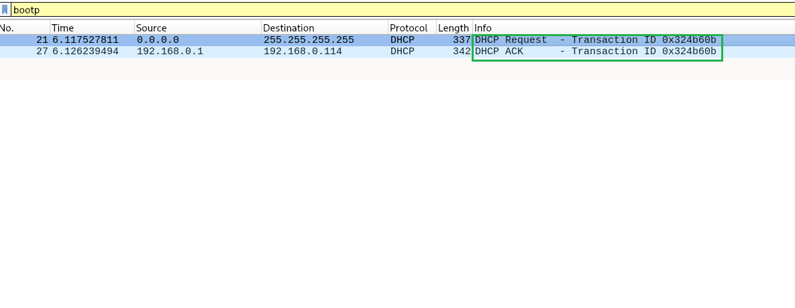
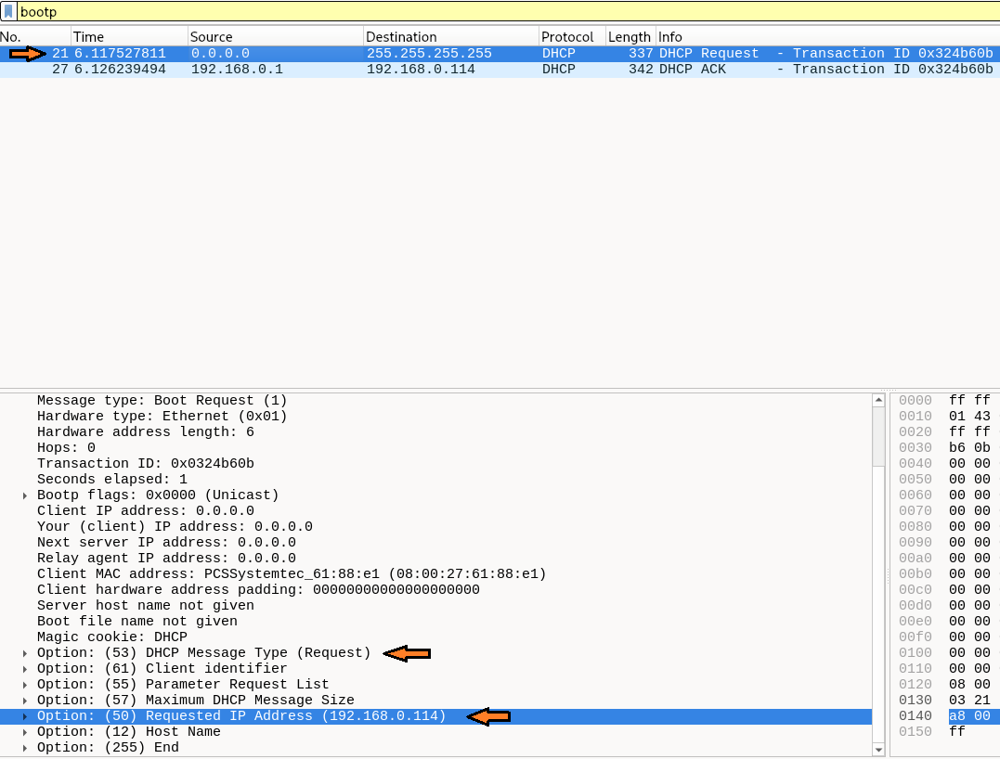
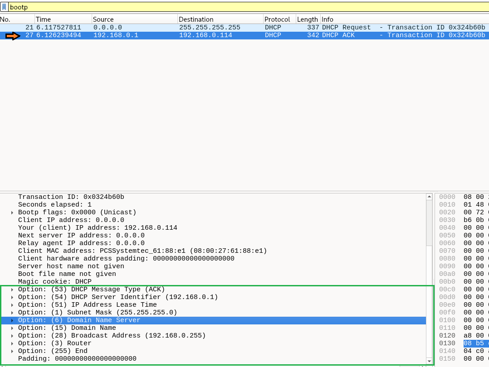

# LAB 6 — Análise do protocolo DHCP no Wireshark

## Objetivo

Capturar e analisar mensagens DHCPv4 na VM Debian, identificar o servidor DHCP, o endereço IPv4 solicitado e as opções fornecidas na concessão. Relacionar as observações com situações de investigação de rede em um SOC N1.

## Ambiente

- Sistema operacional: Debian (VM)
- Interface: `enp0s3`
- Gerenciador de rede: NetworkManager
- Perfil de conexão: `Wired connection 1`
- Endereço IPv4 utilizado: `192.168.0.114/24`
- Gateway: `192.168.0.1`
- Servidor DHCP identificado: `192.168.0.1`
- Ferramentas: `nmcli` e Wireshark

## Verificações iniciais

Identifiquei a interface e o perfil de conexão:

```bash
nmcli device status
```

Confirmei que o perfil utiliza configuração automática de IPv4:

```bash
nmcli -f ipv4.method connection show "Wired connection 1"
```

Resultado: `ipv4.method: auto`.

Consultei as informações DHCP recebidas:

```bash
nmcli -f GENERAL,DHCP4 device show enp0s3
```

Na saída, identifiquei o servidor DHCP `192.168.0.1`, a máscara `255.255.255.0`, o gateway `192.168.0.1`, os servidores DNS `181.213.132.2` e `181.213.132.3` e o tempo de concessão de `3600` segundos (1 hora).

**Observação:** os índices exibidos como `DHCP4.OPTION[1]`, `DHCP4.OPTION[2]` etc. no NetworkManager são posições da lista, **não** os códigos oficiais das opções DHCP. No Wireshark, por exemplo, a opção **1** corresponde à máscara de rede e a opção **54** ao identificador do servidor DHCP.

## Captura do tráfego DHCP

Iniciei a captura na interface `enp0s3` e utilizei o filtro de exibição:

```text
bootp
```

Pelo terminal direto da VM, desativei e reativei o perfil para observar uma nova solicitação de configuração:

```bash
sudo nmcli connection down "Wired connection 1"
sudo nmcli connection up "Wired connection 1"
```

> **Atenção:** esses comandos interrompem temporariamente a conectividade. Foram executados pelo terminal direto da VM, não pela sessão SSH.

### Evidência 1 — Sequência DHCP Request e ACK



Foram observadas duas mensagens com o mesmo identificador de transação (`0x0324b60b`):

| Pacote | Mensagem | Origem | Destino |
|---|---|---|---|
| 21 | DHCP Request | `0.0.0.0` | `255.255.255.255` |
| 27 | DHCP ACK | `192.168.0.1` | `192.168.0.114` |

O Request foi enviado em broadcast, enquanto o ACK foi enviado pelo servidor DHCP ao endereço concedido.

### Evidência 2 — Pacote 21: DHCP Request



No pacote 21, identifiquei:

- **Opção 53:** DHCP Message Type = Request.
- **Opção 50:** Requested IP Address = `192.168.0.114`.
- **Opção 54:** não aparece neste Request.
- **Client IP Address (`ciaddr`):** `0.0.0.0`.

**Minha análise:** a VM solicitou o mesmo endereço IPv4 que já utilizava antes (`192.168.0.114`). Como o cliente ainda não tinha um IP ativo naquele momento, utilizou `0.0.0.0` como origem e `255.255.255.255` como destino. A presença da opção 50 e a ausência da opção 54 são compatíveis com o estado **INIT-REBOOT**, no qual o cliente tenta reutilizar uma concessão conhecida.

### Evidência 3 — Pacote 27: DHCP ACK



No pacote 27, identifiquei o servidor DHCP `192.168.0.1` e a confirmação do endereço `192.168.0.114` no campo **Your (client) IP address**.

As opções mostradas incluem:

| Código DHCP | Opção | Significado |
|---|---|---|
| 53 | DHCP Message Type | Confirma que a mensagem é um ACK |
| 54 | DHCP Server Identifier | Identifica o servidor DHCP: `192.168.0.1` |
| 51 | IP Address Lease Time | Tempo de concessão do endereço |
| 1 | Subnet Mask | Máscara `255.255.255.0` |
| 6 | Domain Name Server | Servidores DNS |
| 15 | Domain Name | Nome de domínio |
| 28 | Broadcast Address | Broadcast `192.168.0.255` |
| 3 | Router | Gateway informado ao cliente |

## Por que não apareceram Discover e Offer?

O processo inicial de obtenção de um endereço DHCP costuma seguir **Discover → Offer → Request → ACK (DORA)**. Porém, após reativar a conexão, minha VM enviou apenas **Request** e recebeu **ACK**.

Isso ocorreu provavelmente porque o cliente manteve informações de uma concessão anterior e tentou reutilizar `192.168.0.114`. Os campos do Request são compatíveis com **INIT-REBOOT**, portanto a ausência de Discover e Offer não indica falha na captura.

## Relação com SOC N1 — Servidor DHCP não autorizado

Durante uma investigação, a **opção 54 (DHCP Server Identifier)** ajuda a identificar o servidor DHCP anunciado na resposta. Se o endereço informado fosse diferente do servidor DHCP autorizado ou esperado na empresa, **valeria a pena investigar**.

Isso **não significa automaticamente um incidente de segurança**. A infraestrutura pode ter sido alterada legitimamente, por exemplo, após uma migração, troca de equipamento ou mudança de configuração. Antes de classificar como possível *Rogue DHCP*, o analista deve comparar a informação com o inventário de ativos, as mudanças autorizadas e os registros da equipe de redes.

Também é importante verificar as opções de **gateway (3)** e **DNS (6)**: alterações não esperadas podem afetar o encaminhamento ou a resolução de nomes. Uma divergência é um **indício a validar**, não prova isolada de ataque.

## Conclusão

Neste laboratório, relacionei a teoria das opções DHCP com uma captura real no Wireshark. Identifiquei o servidor DHCP, o endereço IPv4 solicitado, a confirmação da concessão e os códigos oficiais das opções. Também compreendi por que a negociação observada apresentou **Request e ACK**, sem a sequência DORA completa.

O exercício reforçou a importância de interpretar pacotes e validar alterações de configuração antes de concluir que existe um incidente de segurança.
