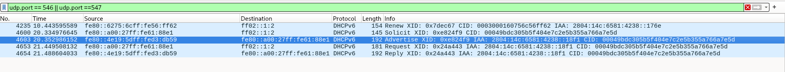
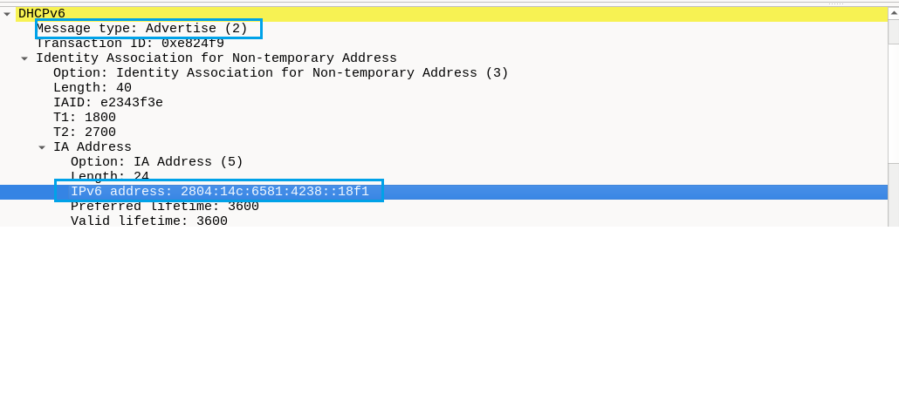
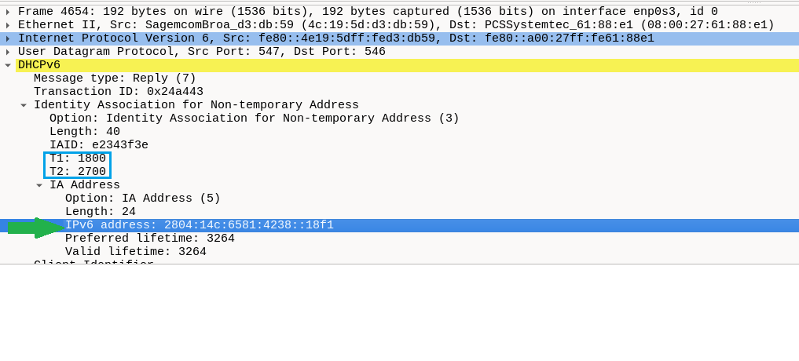

# LAB 04 — Análise do DHCPv6 no Wireshark

## Objetivo

Capturar e interpretar uma negociação **DHCPv6** na rede, identificando as mensagens **Solicit, Advertise, Request e Reply**, o endereço IPv6 oferecido e concedido, os temporizadores de renovação e as informações registradas no Linux. Relacionar os resultados a uma possível investigação de segurança em um **SOC N1**.

## Ambiente

- **Sistema operacional:** VM Debian no VirtualBox
- **Interface:** `enp0s3`
- **Gerenciador de rede:** NetworkManager
- **Conexão:** `Wired connection 1`
- **Ferramentas:** Wireshark, `nmcli` e `journalctl`
- **IPv6 Link-Local da VM:** `fe80::a00:27ff:fe61:88e1`
- **IPv6 Link-Local do servidor DHCPv6 observado:** `fe80::4e19:5dff:fed3:db59`
- **Endereço IPv6 recebido via DHCPv6:** `2804:14c:6581:4238::18f1`

> **Contexto:** no laboratório anterior de Router Advertisement (RA), foram observadas as flags **M=1**, **O=1** e **A=1**. Elas indicavam que a rede anunciava o uso de DHCPv6 e permitia SLAAC. Este laboratório buscou confirmar a atribuição do endereço via DHCPv6.

## 1. Verificação da configuração da interface

Identificar a conexão ativa:

```bash
nmcli device status
```

Resultado relevante: a interface `enp0s3` estava conectada por `Wired connection 1`.

Consultar a configuração IPv6:

```bash
nmcli -f ipv6.method,ipv6.addr-gen-mode,ipv6.dhcp-duid connection show "Wired connection 1"
```

Resultados observados:

```text
ipv6.method:        auto
ipv6.addr-gen-mode: default-or-eui64
ipv6.dhcp-duid:      --
```

O modo `auto` permite a configuração IPv6 com base em anúncios do roteador e, conforme a rede, o uso de DHCPv6. O campo `ipv6.dhcp-duid: --` apenas indica ausência de um valor personalizado nessa propriedade; não significa que DHCPv6 esteja desativado.

Consultar as opções recebidas pelo DHCPv6:

```bash
nmcli -f DHCP6 device show enp0s3
```

Informações encontradas:

```text
dhcp6_domain_search = home
dhcp6_name_servers = 2804:14d:1:0:181:213:132:2 2804:14d:1:0:181:213:132:3
ip6_address = 2804:14c:6581:4238::18f1
```

Essa consulta forneceu evidência de que o NetworkManager tinha uma concessão DHCPv6 com o endereço identificado anteriormente na VM.

## 2. Captura no Wireshark

Iniciar a captura na interface `enp0s3` e utilizar o filtro de exibição:

```wireshark
udp.port == 546 || udp.port == 547
```

- **UDP 546:** porta do cliente DHCPv6.
- **UDP 547:** porta do servidor DHCPv6.

Inicialmente, uma captura de mais de cinco minutos não mostrou mensagens DHCPv6. O comando `sudo nmcli device reapply enp0s3` também não gerou uma nova negociação visível. A ausência de pacotes nesse intervalo **não comprova ausência do protocolo**, pois uma concessão pode estar ativa e não exigir troca de mensagens naquele momento.

Para provocar uma nova ativação da conexão, foi utilizado:

```bash
sudo nmcli connection down "Wired connection 1" && sudo nmcli connection up "Wired connection 1"
```

> **Atenção:** o comando interrompe temporariamente a conectividade. Deve ser executado no console local da VM, e não em uma sessão SSH que dependa da mesma interface.

Após nova captura, foram identificadas as mensagens DHCPv6.

### Pacotes observados

| Pacote | Mensagem | Origem | Destino | Função |
|---|---|---|---|---|
| 4235 | Renew | Cliente IPv6 Link-Local diferente | `ff02::1:2` | Tentativa de renovação observada separadamente; não integra a sequência abaixo |
| 4600 | Solicit (1) | `fe80::a00:27ff:fe61:88e1` | `ff02::1:2` | Procura servidores DHCPv6 |
| 4603 | Advertise (2) | `fe80::4e19:5dff:fed3:db59` | `fe80::a00:27ff:fe61:88e1` | Anuncia uma oferta de configuração |
| 4653 | Request (3) | `fe80::a00:27ff:fe61:88e1` | `ff02::1:2` | Solicita a configuração ao servidor escolhido |
| 4654 | Reply (7) | `fe80::4e19:5dff:fed3:db59` | `fe80::a00:27ff:fe61:88e1` | Responde à solicitação com a concessão |

O multicast `ff02::1:2` é utilizado para alcançar servidores e agentes de retransmissão DHCPv6 no enlace local.

**Figura 1 — Mensagens DHCPv6 capturadas no Wireshark**



## 3. Análise do Advertise — pacote 4603

No pacote **Advertise**, foram observados:

- **Message Type:** `Advertise (2)`
- **Transaction ID:** `0xe824f9` — o mesmo do Solicit (pacote 4600)
- **IA_NA:** associação para endereço IPv6 não temporário
- **IA Address:** `2804:14c:6581:4238::18f1`
- **Preferred Lifetime:** `3600` segundos (60 minutos)
- **Valid Lifetime:** `3600` segundos (60 minutos)
- **Client Identifier / Server Identifier:** identificadores DUID do cliente e do servidor
- **DNS e Domain Search List:** opções de configuração fornecidas pelo servidor

O **Advertise é uma oferta**, não a confirmação final da concessão. O endereço oferecido coincide com o endereço anteriormente identificado no NetworkManager.

**Figura 2 — Advertise e endereço IPv6 oferecido**



## 4. Análise do Request e Reply — pacotes 4653 e 4654

O **Request** e o **Reply** compartilham o Transaction ID `0x24a443`, permitindo correlacionar o pedido à resposta. Esse identificador é diferente do utilizado no par Solicit/Advertise; cada troca pode utilizar seu próprio Transaction ID.

No pacote **Reply (7)**, foram observados:

| Campo | Valor | Interpretação |
|---|---|---|
| Transaction ID | `0x24a443` | Relaciona Reply ao Request |
| IAID | `e2343f3e` | Identificador da associação de endereços |
| IPv6 Address | `2804:14c:6581:4238::18f1` | Endereço concedido |
| T1 | `1800` segundos | Momento de iniciar a tentativa de renovação (Renew) |
| T2 | `2700` segundos | Momento de iniciar a tentativa de religação (Rebind), se necessário |
| Preferred Lifetime | `3264` segundos | Período de uso preferencial anunciado no Reply |
| Valid Lifetime | `3264` segundos | Período de validade anunciado no Reply |

### Entendendo os temporizadores

- **T1 = 1800 s (30 min):** o cliente normalmente tenta renovar com o servidor responsável pela concessão, por meio de **Renew**.
- **T2 = 2700 s (45 min):** caso não consiga renovar, o cliente pode enviar **Rebind** para obter resposta de outros servidores disponíveis.
- **Valid Lifetime = 3264 s:** quando o tempo válido do endereço termina sem extensão da concessão, ele não pode mais ser utilizado.

Os tempos de vida no Advertise eram de **3600 s** e no Reply de **3264 s**. Isso pode refletir o tempo restante de uma concessão já existente; não é, isoladamente, evidência de erro. Os valores devem ser interpretados como os tempos anunciados em cada mensagem, e não como garantia de que o endereço será renovado exatamente nesses instantes.

**Figura 3 — Reply, endereço concedido, T1 e T2**



## 5. Correlação com os logs do Linux

Para investigar por que inicialmente não apareciam pacotes no Wireshark, foi consultado o serviço NetworkManager:

```bash
sudo journalctl -u NetworkManager --since "30 minutes ago" --no-pager | grep -Ei 'dhcp6|dhcpv6' | tail -n 30
```

Exemplo de eventos encontrados:

```text
dhcp6 (enp0s3): canceled DHCP transaction
dhcp6 (enp0s3): activation: beginning transaction (timeout in 45 seconds)
dhcp6 (enp0s3): state changed no lease
dhcp6 (enp0s3): state changed new lease, address=2804:14c:6581:4238::18f1
```

Os registros confirmaram que o NetworkManager iniciou transações DHCPv6 e obteve uma concessão. A captura posterior mostrou as mensagens de rede correspondentes ao processo de obtenção de endereço.

**Lição de troubleshooting:** quando a captura não apresenta o tráfego esperado, vale consultar outras fontes de evidência, conferir a interface selecionada, os filtros e o período da captura antes de concluir que o protocolo não está funcionando.

## 6. Relação entre SLAAC, Router Advertisement e DHCPv6

Na VM, **SLAAC e DHCPv6 funcionaram simultaneamente**:

| Informação | Origem observada |
|---|---|
| Prefixo IPv6 `/64` para autoconfiguração | Router Advertisement (RA) |
| Endereços IPv6 globais autoconfigurados | SLAAC |
| Gateway padrão IPv6 | Router Advertisement (RA) |
| Endereço `2804:14c:6581:4238::18f1` | DHCPv6 |
| Servidores DNS | Anunciados tanto por RA/RDNSS quanto por DHCPv6 |
| Domínio de pesquisa `home` | DHCPv6 |

**Diferença importante em relação ao DHCPv4:** no cenário observado, o gateway padrão IPv6 foi aprendido por RA, e não pela concessão DHCPv6.

## 7. Aplicação em SOC N1 — investigação de DHCPv6 suspeito

Um analista SOC pode investigar um possível servidor DHCPv6 não autorizado comparando as respostas observadas na rede com as informações da infraestrutura corporativa.

**Exemplo de hipótese:** uma estação começa a receber endereços ou servidores DNS inesperados de um servidor DHCPv6 diferente do habitual.

**Passos de triagem:**

1. Identificar as mensagens **Advertise** e **Reply** e seus horários.
2. Registrar IPv6 de origem, endereço MAC e **Server Identifier (DUID)** do servidor.
3. Comparar os dados com o inventário de equipamentos, servidores DHCPv6 autorizados e mudanças aprovadas (CMDB/CRQ).
4. Verificar endereços e opções DNS anunciados, alterações recentes e possíveis impactos em outras estações.
5. Correlacionar a captura com logs do sistema, switches, roteadores e ferramentas de monitoramento disponíveis.
6. Escalar para investigação de incidente **somente quando as evidências sustentarem a suspeita**, seguindo o processo da organização.

> **Atenção:** um servidor DHCPv6 diferente, por si só, não comprova ataque. Pode ser uma mudança legítima, substituição de equipamento ou alteração de topologia.

Da mesma forma, mensagens **Renew** próximas do T1 são normalmente esperadas e não representam, isoladamente, um incidente.

## 8. Conclusão

O laboratório permitiu:

- Confirmar o uso de **DHCPv6** na VM Debian.
- Capturar e interpretar **Solicit → Advertise → Request → Reply** no Wireshark.
- Identificar o endereço IPv6 oferecido e concedido.
- Compreender os temporizadores **T1**, **T2**, **Preferred Lifetime** e **Valid Lifetime**.
- Correlacionar a captura com as informações do **NetworkManager** e do **journalctl**.
- Diferenciar o papel do **DHCPv6** daquele do **SLAAC/RA**.
- Exercitar a análise de evidências e o raciocínio de triagem aplicáveis ao **SOC N1**.

Este exercício complementa os laboratórios de IPv6, Router Advertisement e NDP, formando uma base prática para revisão e futuras investigações de tráfego de rede.
