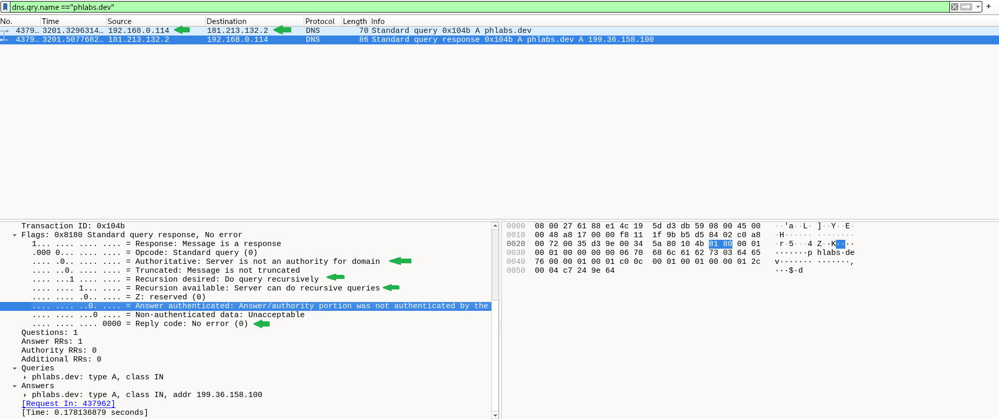
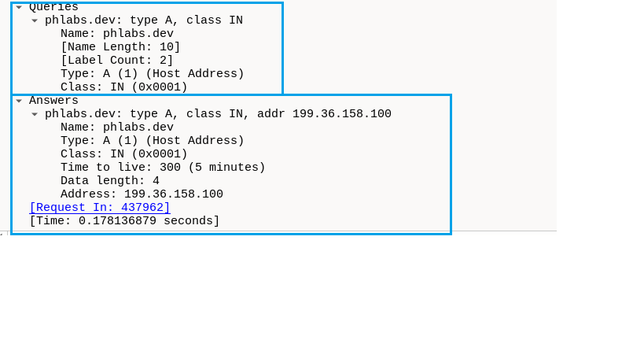
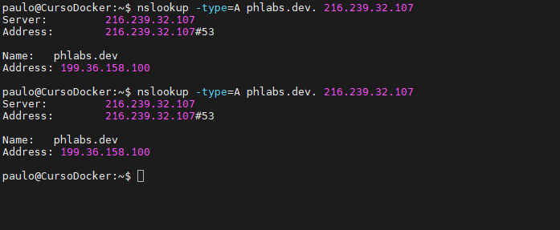
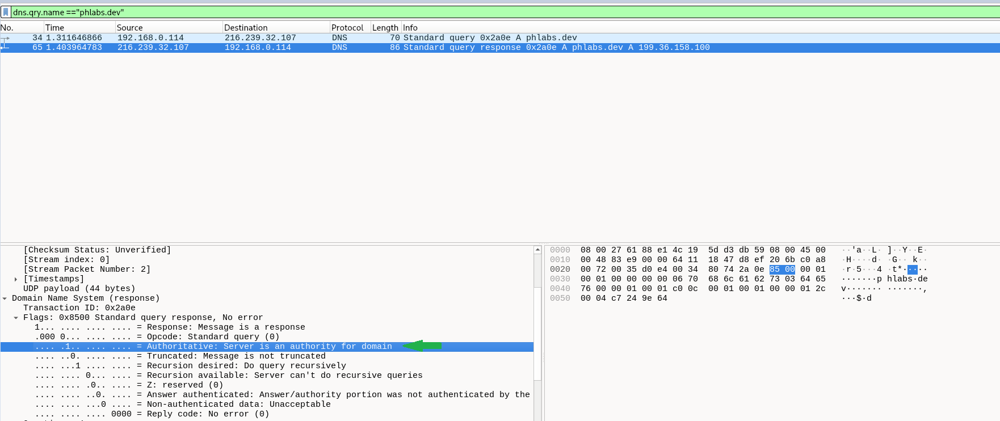
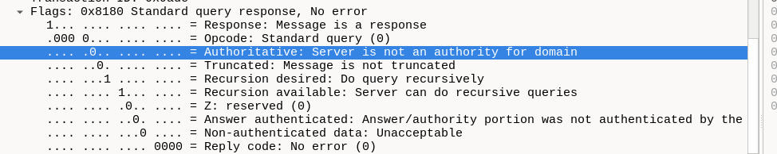
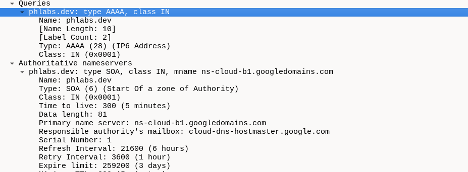
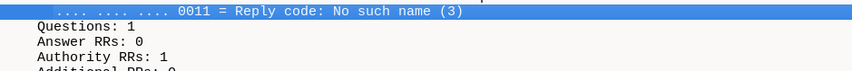
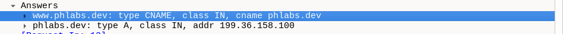

# LAB — DNS no Wireshark com domínio próprio

## Objetivo

Analisar consultas DNS com `nslookup` e Wireshark, usando o domínio `phlabs.dev`: registros A, AAAA, NS, CNAME e MX, respostas autoritativas e não autoritativas e diferença entre NODATA e NXDOMAIN.

## Ambiente

- Debian em VM: `192.168.0.114`, interface `enp0s3`.
- Windows para comparação com o Debian.
- Resolvedor consultado no Debian: `181.213.132.2`, porta 53.
- Zona pública administrada no Google Cloud DNS.
- Ferramentas: nslookup e Wireshark.

## 1. Consulta ao resolvedor e registro A

```bash
nslookup -type=A phlabs.dev.
```

Filtro no Wireshark:

```wireshark
dns.qry.name == "phlabs.dev"
```

A VM consultou `181.213.132.2`, que retornou `199.36.158.100`. A pergunta e a resposta tinham o mesmo Transaction ID: `0x104b`. A resposta usou UDP, da porta 53 para a porta temporária 54174 do cliente.

**A significa Address, não Authoritative:** associa o nome a um IPv4. O endereço do resolvedor e o endereço retornado no registro A têm funções diferentes.

No Windows, a consulta foi enviada a um resolvedor por IPv6 e também retornou esse registro A. O transporte da consulta é independente do tipo de registro solicitado.





O TTL DNS observado foi de **300 segundos (5 minutos)**, indicando o tempo pelo qual o registro pode ser mantido em cache a partir dessa resposta. Ele não é o TTL do cabeçalho IPv4. Nos testes repetidos, permaneceu em 300; isso, sozinho, não permite determinar o comportamento do cache do resolvedor.

## 2. NS e consulta direta ao autoritativo

```bash
nslookup -type=NS phlabs.dev.
nslookup -type=A phlabs.dev. 216.239.32.107
```

Os registros NS retornados corresponderam aos servidores apresentados na GCP:

| Servidor autoritativo | IPv4 |
| --- | --- |
| ns-cloud-b1.googledomains.com | 216.239.32.107 |
| ns-cloud-b2.googledomains.com | 216.239.34.107 |
| ns-cloud-b3.googledomains.com | 216.239.36.107 |
| ns-cloud-b4.googledomains.com | 216.239.38.107 |

**Os NS indicam quem publica essa informação.** Quando necessário:

1. O resolvedor precisa descobrir o IPv4 de `phlabs.dev`.
2. Segue a hierarquia DNS e encontra a indicação dos NS responsáveis pela zona.
3. Consulta um deles, como `ns-cloud-b1.googledomains.com`.
4. Esse servidor responde com o registro **A: 199.36.158.100**.
5. O resolvedor entrega o resultado à máquina cliente.

Sem as informações necessárias em cache, o resolvedor consulta a raiz, que indica os servidores de `.dev`; o TLD indica os autoritativos de `phlabs.dev`; um autoritativo fornece o registro. O cache pode encurtar esse caminho. A captura na VM mostra a comunicação com o resolvedor, mas não as consultas externas que ele fez.

Ao informar `216.239.32.107` no comando, a própria VM consultou diretamente o autoritativo.





### Flags observadas

| Campo | Pelo resolvedor | Direto ao autoritativo | Significado |
| --- | --- | --- | --- |
| QR | 1 | 1 | Mensagem de resposta |
| AA | 0 | 1 | Indica resposta autoritativa |
| TC | 0 | 0 | Resposta não truncada |
| RD | 1 | 1 | Cliente solicitou recursão |
| RA | 1 | 0 | Servidor informa se oferece recursão |
| RCODE | 0 | 0 | NOERROR: sem erro de processamento |

**AA = 0 corresponde à mensagem “Non-authoritative answer” do nslookup.** Ela se refere à autoridade de quem respondeu, não ao IPv4 publicado no registro A. Não indica erro nem comprova uso de cache.

Podemos interpretar a resposta do resolvedor assim:

> O registro A de `phlabs.dev` é `199.36.158.100`. Estou entregando essa informação, mas não sou o servidor responsável oficialmente pela zona desse domínio.

Os servidores autoritativos publicam os registros da zona e são identificados por NS. Na consulta direta, AA foi 1 e a mensagem “Non-authoritative answer” não apareceu. RD = 1 e RA = 0 puderam coexistir: o servidor não ofereceu recursão, mas respondeu porque atendia a zona consultada.

O campo AD estava em 0: a resposta não sinalizou dados autenticados pelo resolvedor. Isso, sozinho, não comprova que DNSSEC esteja desativado nem indica domínio malicioso.

## 3. Ausência de registro e nome inexistente

```bash
nslookup -type=AAAA phlabs.dev.
nslookup -type=A naoexiste-lab-001.phlabs.dev.
```

| Consulta | Resultado | Interpretação |
| --- | --- | --- |
| A de phlabs.dev | NOERROR com registro A | IPv4 retornado |
| AAAA de phlabs.dev | NOERROR sem registro solicitado — NODATA | Nome existe, sem AAAA |
| A de naoexiste-lab-001.phlabs.dev | NXDOMAIN — código 3 | Nome completo não existe |

NODATA não é um RCODE separado. Na consulta AAAA, o terminal exibiu “No answer”; a captura mostrou NOERROR e um SOA na seção de autoridade. O SOA contém informações administrativas da zona e participa da definição do cache negativo. O título “Authoritative nameservers” dessa seção não substitui a flag AA.







## 4. CNAME e cache negativo

Inicialmente, `www.phlabs.dev` retornou NXDOMAIN. Foi criado na GCP:

| Nome | Tipo | Destino | TTL |
| --- | --- | --- | --- |
| www.phlabs.dev | CNAME | phlabs.dev. | 300 |

Após a criação, o resolvedor ainda retornou NXDOMAIN, enquanto o autoritativo já retornou o alias. Isso é compatível com **cache negativo** no resolvedor, sem provar sua causa isoladamente.

```bash
nslookup -type=CNAME www.phlabs.dev. 216.239.32.107
nslookup -type=A www.phlabs.dev. 216.239.32.107
```

A segunda consulta retornou, na mesma resposta:

| Nome | Tipo | Valor |
| --- | --- | --- |
| www.phlabs.dev | CNAME | phlabs.dev |
| phlabs.dev | A | 199.36.158.100 |



O CNAME associa um nome a outro nome, não a um IP. Ele não configura redirecionamento HTTP nem garante que o site aceite o alias.

## 5. Registros MX

```bash
nslookup -type=MX phlabs.dev.
nslookup -type=MX gmail.com.
```

Não foi encontrado MX para `phlabs.dev`. Já `gmail.com` retornou:

| Preferência | Servidor |
| --- | --- |
| 5 | gmail-smtp-in.l.google.com |
| 10 | alt1.gmail-smtp-in.l.google.com |
| 20 | alt2.gmail-smtp-in.l.google.com |
| 30 | alt3.gmail-smtp-in.l.google.com |
| 40 | alt4.gmail-smtp-in.l.google.com |

Quanto menor o número, maior a prioridade de tentativa. A ordem das linhas no terminal não define a preferência.

**NS indica quem responde pelo DNS da zona; MX indica os servidores que recebem e-mail para o domínio.** O contato administrativo `mail addr` exibido no SOA não é um registro MX.

## Relação com o SOC N1

- Identificar o cliente, o resolvedor, o nome consultado, o tipo de registro e o resultado.
- Diferenciar ausência de um registro, nome inexistente e resposta não autoritativa.
- Considerar cache e mudanças recentes antes de interpretar resultados divergentes.
- Usar respostas DNS para apoiar a correlação com conexões e logs do endpoint: resolver um nome não comprova que houve conexão ao endereço retornado.
- Um NXDOMAIN isolado pode resultar de digitação incorreta ou configuração antiga. AA = 0 também não indica ameaça. Frequência, domínio, processo e outros eventos precisam de contexto antes de classificar uma atividade como suspeita.

## Conclusão

O laboratório relacionou a configuração de uma zona própria aos resultados do nslookup e aos campos capturados no Wireshark, diferenciando resolvedor, autoritativo, tipos de registro e respostas negativas.
