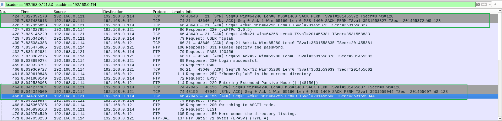
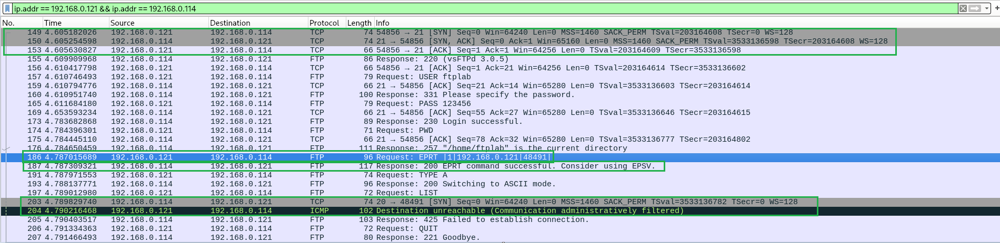
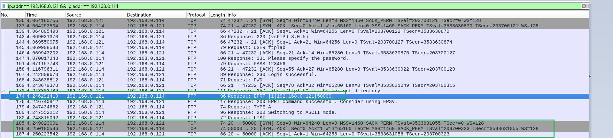

# LAB — FTP: autenticação, modos passivo e ativo

## Objetivo

Observar no Wireshark o handshake TCP, a autenticação sem criptografia e a separação entre controle e dados no FTP.

## Ambiente

| Papel | Sistema | IP |
|---|---|---|
| Servidor FTP | Debian 13 — vsftpd 3.0.5 | `192.168.0.114` |
| Cliente | Rocky Linux 10.1 — curl | `192.168.0.121` |

Servidor configurado com acesso local habilitado, acesso anônimo desabilitado e sem TLS. Foi criado o usuário local `ftplab`, com diretório pessoal `/home/ftplab` e arquivo de teste `teste-ftp.txt`. As credenciais usadas são fictícias, exclusivas do laboratório.

## Usuário Linux e diretório inicial do FTP

A conta foi criada no Debian com:

```bash
sudo adduser ftplab
```

O comando criou o usuário no Linux, criou `/home/ftplab` e registrou esse caminho como seu diretório pessoal. Não foi criada uma conta independente no FTP: com `local_enable=YES`, o vsftpd permite autenticação com contas locais.

Credenciais exclusivas deste laboratório: usuário `ftplab`, senha `123456`. Os IPs privados e a senha fictícia foram mantidos para documentar o teste.

Como não configuramos outro diretório inicial no vsftpd, a sessão começou no diretório pessoal do usuário. Isso foi confirmado pelo comando `PWD` e pela resposta `257 "/home/ftplab" is the current directory`.

| Conceito | Significado |
|---|---|
| Diretório inicial | Pasta em que a sessão começa após o login; neste teste, `/home/ftplab`. |
| Restrição por chroot | Limite da árvore de diretórios acessível pela sessão; a pasta usada como limite aparece como `/` para o cliente. |

Começar em `/home/ftplab` não significa estar restrito a essa pasta. Não configuramos chroot neste laboratório; a navegação para outros diretórios depende das permissões do Linux.

## Execução

No cliente, foi executado:

```bash
curl -v --user ftplab ftp://192.168.0.114/
```

O curl solicitou a senha no terminal antes de iniciar a conexão. No Wireshark do servidor, foi utilizado o filtro de exibição:

```wireshark
ip.addr == 192.168.0.121 && ip.addr == 192.168.0.114
```

## Captura e análise



### 1. Conexão de controle e autenticação

| Pacotes | Observação |
|---|---|
| 424–426 | Handshake TCP: `SYN → SYN, ACK → ACK`, do cliente `43640` para a porta `21` do servidor. |
| 427 | Resposta `220`: serviço pronto, anunciando `vsFTPd 3.0.5`. |
| 429 | Cliente envia `USER ftplab`. |
| 431 | Servidor responde `331`, solicitando a senha. |
| 432 | Cliente envia `PASS 123456`, legível na captura. |
| 458 | Resposta `230 Login successful`: autenticação bem-sucedida. |
| 459–461 | Comando `PWD` e resposta `257`, indicando `/home/ftplab` como diretório atual. |

**Como utilizamos FTP tradicional, sem TLS (`ssl_enable=NO`), os comandos, as respostas, o usuário, a senha e os dados da listagem trafegaram em texto claro, visíveis no Wireshark. Não houve descriptografia: as informações já foram transmitidas sem criptografia.**

Os ACKs do TCP confirmam o recebimento dos bytes; não comprovam que a aplicação aceitou as credenciais. A confirmação do login é a resposta FTP `230`. O código `331`, isoladamente, não comprova que o usuário existe.

### 2. Modo passivo estendido e conexão de dados

| Pacotes | Observação |
|---|---|
| 462 | Cliente envia `EPSV` pela conexão de controle. |
| 463 | Servidor responde `229 Entering Extended Passive Mode (\|\|\|48156\|)`, informando a porta de dados. |
| 464–466 | Novo handshake TCP: cliente `47046` → servidor `48156`. |
| 467–468 | `TYPE A` e resposta `200`: seleção do modo ASCII. |
| 469–470 | Comando `LIST` e resposta `150`, indicando início da operação de listagem. |
| 471 | Tráfego `FTP-DATA` transportando os dados da listagem. |

O comando `EPSV` e a resposta `229` passam pela porta `21`. Em seguida, o cliente inicia a conexão de dados com o mesmo IP do servidor, na porta informada (`48156`). Isso caracteriza o modo passivo; a porta pode mudar em outra operação.

Neste teste, foram estabelecidas duas conexões TCP:

- **Controle:** `192.168.0.121:43640 → 192.168.0.114:21`, para comandos e respostas.
- **Dados:** `192.168.0.121:47046 → 192.168.0.114:48156`, para a listagem do diretório.

A listagem exibiu `teste-ftp.txt` no terminal. O conteúdo desse arquivo ainda não foi baixado: o `LIST` transfere a listagem, enquanto o download de arquivo utiliza `RETR`.

## Modo ativo: bloqueio e liberação no firewall

No modo ativo, o cliente informa onde receberá a conexão de dados, e o servidor inicia essa conexão. A configuração do Debian continha `connect_from_port_20=YES`: o servidor usa a porta de origem TCP `20` na conexão de dados ativa, sem precisar ficar escutando nela.

### 1. Tentativa bloqueada

Comando executado no Rocky:

```bash
curl -v --ftp-port 192.168.0.121 --user ftplab ftp://192.168.0.114/
```



| Pacote | Observação |
|---|---|
| 173 | `230 Login successful`: autenticação concluída pela conexão de controle. |
| 186 | Cliente envia `EPRT \|1\|192.168.0.121\|48491\|`: informa IPv4 (`1`), seu IP e a porta de dados. |
| 187 | Resposta `200`: servidor aceita o comando EPRT. |
| 197 | Cliente solicita `LIST`. |
| 203 | Servidor envia `SYN`: `192.168.0.114:20 → 192.168.0.121:48491`. |
| 204 | Rocky responde com ICMP `Destination unreachable (Communication administratively filtered)`. |
| 205 | Servidor responde `425 Failed to establish connection`. |

A conexão de controle funcionou, mas o handshake da conexão de dados não foi concluído. O ICMP indicou um bloqueio administrativo, diferente de um descarte silencioso. A resposta `200` confirmou apenas a aceitação do EPRT, não o estabelecimento da conexão de dados.

No Rocky, os comandos abaixo confirmaram o firewalld ativo e a interface `enp0s3` na zona `public`:

```bash
firewall-cmd --state
firewall-cmd --get-active-zones
```

### 2. Liberação temporária e novo teste

Foi permitida no Rocky a entrada TCP na porta `50000`, somente a partir do Debian, por 15 minutos:

```bash
firewall-cmd --zone=public --add-rich-rule='rule family="ipv4" source address="192.168.0.114" port port="50000" protocol="tcp" accept' --timeout=15m
```

A regra é temporária e expira automaticamente. Em uma nova captura, o cliente foi configurado para receber a conexão nessa porta fixa:

```bash
curl -v --ftp-port 192.168.0.121:50000-50000 --user ftplab ftp://192.168.0.114/
```



| Pacote | Observação |
|---|---|
| 174 | Cliente envia `EPRT \|1\|192.168.0.121\|50000\|`. |
| 176 | Servidor responde `200`, aceitando o EPRT. |
| 182 | Cliente solicita `LIST`. |
| 185 | Servidor envia `SYN`, da porta `20` para a porta `50000` do cliente. |
| 186 | Cliente responde `SYN, ACK`. |
| 187 | Servidor envia `ACK`: handshake da conexão de dados concluído. |

O print registra o estabelecimento da conexão de dados; a listagem também funcionou, conforme verificado durante o teste. O resultado após a liberação reforça o diagnóstico de bloqueio pelo firewall do cliente na tentativa anterior.

### Comparação dos modos observados

| Modo | Negociação pela conexão de controle | Quem inicia a conexão de dados | Exemplo capturado |
|---|---|---|---|
| Passivo estendido | `EPSV` / `229` | Cliente | Cliente `47046` → servidor `48156` |
| Ativo estendido | `EPRT` / `200` | Servidor | Servidor `20` → cliente `50000` |

Nos dois modos, o cliente inicia a conexão de controle com a porta `21` do servidor. As operações realizadas foram listagens de diretório (`LIST`), sem download do conteúdo do arquivo.

## Relação com SOC N1

- Identificar credenciais e comandos expostos em uma sessão FTP sem criptografia.
- Distinguir conexão TCP estabelecida de autenticação bem-sucedida na aplicação.
- Correlacionar a negociação `EPSV/229` com a nova conexão de dados, sem depender apenas da porta `21`.
- Entender que listagens também usam a conexão de dados; comandos e resultados podem aparecer em fluxos TCP diferentes.
- Usar o banner como informação de investigação, sem concluir vulnerabilidade apenas pela versão anunciada.
- Correlacionar EPRT, SYN do servidor, resposta ICMP e erro FTP `425` para investigar uma falha na conexão de dados.
- Reconhecer que login bem-sucedido não garante sucesso da listagem ou transferência; conexões diferentes podem receber tratamentos distintos no firewall.

## Escopo desta etapa

Foram observados login com conta local, listagem, modo passivo estendido e modo ativo estendido, incluindo bloqueio e liberação da conexão de dados. Download, upload e acesso anônimo ainda não foram testados.
