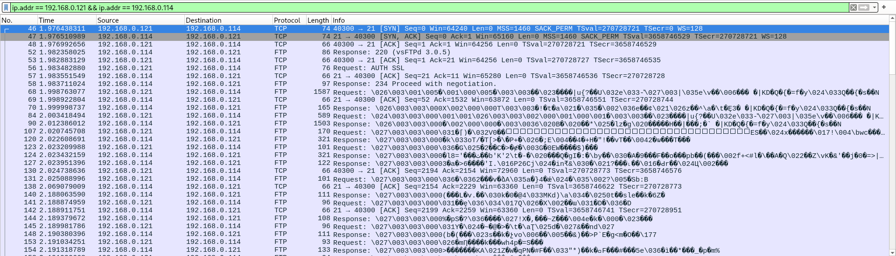
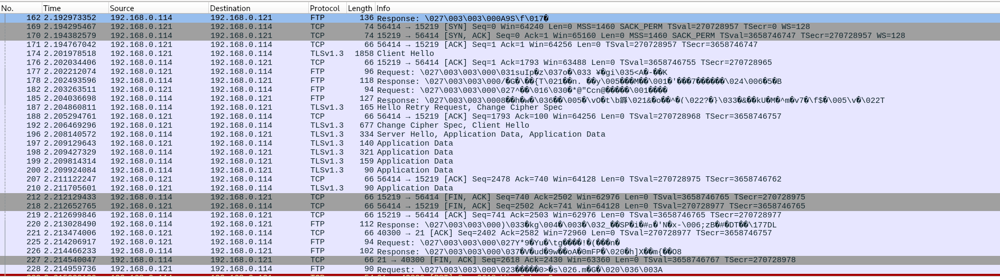
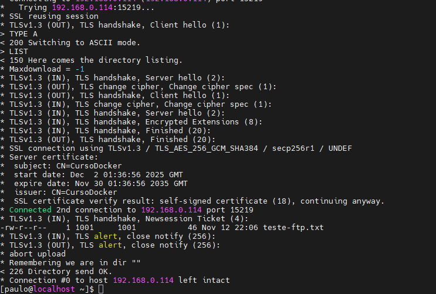

# LAB — FTPS: proteção das conexões de controle e dados com TLS

## Objetivo

Habilitar TLS no vsftpd e comparar o FTP em texto claro com o FTPS, observando a negociação e a proteção da conexão de controle e da listagem de diretório.

## Ambiente

| Papel | Sistema | IP |
|---|---|---|
| Servidor FTPS | Debian 13 — vsftpd 3.0.5 | `192.168.0.114` |
| Cliente | Rocky Linux 10.1 — curl | `192.168.0.121` |

Foi mantida a conta local `ftplab`, com senha fictícia `123456`, diretório inicial `/home/ftplab` e arquivo `teste-ftp.txt`, utilizados no laboratório anterior. Acesso anônimo desabilitado.

## Configuração do TLS no servidor

Antes da alteração, foi realizado o backup:

```bash
sudo cp -a /etc/vsftpd.conf /etc/vsftpd.conf.antes-tls
```

Em `/etc/vsftpd.conf`, a opção existente `ssl_enable=NO` foi alterada para `ssl_enable=YES`, e foram acrescentadas as exigências de proteção para login e dados:

```ini
ssl_enable=YES
force_local_logins_ssl=YES
force_local_data_ssl=YES
```

Foram mantidos o certificado autoassinado e a chave privada já existentes no Debian:

```ini
rsa_cert_file=/etc/ssl/certs/ssl-cert-snakeoil.pem
rsa_private_key_file=/etc/ssl/private/ssl-cert-snakeoil.key
```

Não foi necessário substituir o vsftpd. Após a alteração, o serviço foi reiniciado e apresentou estado `active (running)`:

```bash
sudo systemctl restart vsftpd
sudo systemctl status vsftpd --no-pager
```

## Execução

No Rocky, foi executado:

```bash
curl -v --ssl-reqd --insecure --user ftplab ftp://192.168.0.114/
```

| Opção | Finalidade |
|---|---|
| `-v` | Exibir comandos, respostas e detalhes da negociação no terminal |
| `--ssl-reqd` | Exigir TLS para controle e dados |
| `--insecure` | Dispensar a validação do certificado neste teste com certificado autoassinado |
| `--user ftplab` | Informar o usuário e solicitar a senha no terminal |

Foi utilizado **FTPS explícito**: a conexão começa na porta `21` e negocia TLS antes das credenciais. Com `--insecure`, os dados continuam criptografados, mas o cliente não valida a confiança e a correspondência do certificado com o servidor esperado.

No Wireshark do Debian, a captura foi realizada na interface `enp0s3`, com o filtro de exibição:

```wireshark
ip.addr == 192.168.0.121 && ip.addr == 192.168.0.114
```

## Captura e análise

### 1. Conexão de controle e início da negociação TLS



| Pacotes | Observação |
|---|---|
| 46–48 | Handshake TCP: cliente `40300` → servidor `21`. |
| 52 | Banner `220 (vsFTPd 3.0.5)`, ainda legível. |
| 56 | Cliente envia `AUTH SSL`, solicitando a negociação de proteção. |
| 58 | Servidor aceita: `234 Proceed with negotiation`. |
| A partir de 68 | Começa a negociação TLS, seguida por registros protegidos. |

Nesta conexão, o Wireshark continuou classificando os bytes como FTP, exibindo caracteres estranhos. Isso não significa que os comandos continuaram em texto claro. O início inclui mensagens binárias do handshake; depois, usuário, senha e comandos ficam protegidos. A saída do curl confirmou TLS 1.3, apesar do nome do comando `AUTH SSL`.

### 2. Conexão de dados no modo passivo com TLS



| Pacotes | Observação |
|---|---|
| 169–171 | Novo handshake TCP: cliente `56414` → servidor `15219`. |
| 174 | `Client Hello`: início da negociação TLS na conexão de dados. |
| 187 | `Hello Retry Request`: servidor solicita ajuste na negociação. |
| 192–193 | Novo `Client Hello` e resposta `Server Hello`. |
| 197–210 | Registros protegidos identificados como `Application Data`. |
| 212–219 | Encerramento TCP da conexão de dados com FINs e confirmações. |

O cliente iniciou a segunda conexão, caracterizando o modo passivo. A porta de dados desta execução foi `15219`; ela pode mudar em outra operação. O `Hello Retry Request` faz parte da negociação e não representa, isoladamente, uma falha.

Na saída detalhada do cliente, também foi observado `PROT P`, aceito com `200 PROT now Private`, solicitando proteção para os dados. Assim, a proteção não ficou limitada ao login e aos comandos.

### 3. Confirmação da listagem no terminal



| Evidência | Significado |
|---|---|
| `TLSv1.3 / TLS_AES_256_GCM_SHA384` | TLS 1.3 negociado na conexão de dados. |
| `Connected 2nd connection ... port 15219` | Conexão de dados estabelecida com o servidor. |
| `teste-ftp.txt` | Arquivo exibido na listagem recebida. |
| `close notify` | Notificação de encerramento TLS. |
| `226 Directory send OK` | Confirmação FTP de conclusão da listagem. |

A mensagem de depuração `abort upload` não significou falha nesta operação: não estava sendo realizado upload, e a listagem foi recebida e confirmada pelo código `226`.

## Comparação com o FTP sem TLS

| Aspecto | FTP do laboratório anterior | FTPS deste laboratório |
|---|---|---|
| Usuário e senha na captura | Visíveis em texto claro | Protegidos após a negociação TLS |
| Comandos e respostas após a negociação | Legíveis | Protegidos |
| Dados da listagem | Em texto claro | Protegidos por TLS na segunda conexão |
| IPs, portas e flags TCP | Visíveis | Continuam visíveis |
| Controle e dados | Duas conexões TCP | Duas conexões TCP, ambas protegidas |

Os comandos ainda podem aparecer no terminal com `curl -v`, porque o cliente conhece o conteúdo que envia e recebe. Isso não significa que o mesmo conteúdo esteja legível na rede. Da mesma forma, os caracteres estranhos, isoladamente, não comprovam criptografia: a análise foi complementada pela negociação TLS reconhecida e pela saída do curl.

## Relação com SOC N1

- Reconhecer a transição de FTP em texto claro para uma sessão protegida por TLS.
- Diferenciar informações visíveis de rede, como IPs e portas, do conteúdo criptografado.
- Correlacionar controle e dados, verificando a proteção nas duas conexões.
- Entender que captura criptografada limita a leitura de comandos e credenciais; logs do cliente e do servidor complementam a investigação.
- Distinguir criptografia de validação da identidade: `--insecure` dispensa a validação do certificado, mesmo com TLS funcionando.
- Confirmar o resultado na aplicação com `226`, além de observar handshake e encerramento TCP.

## Escopo desta etapa

Foram observados FTPS explícito, login com conta local, modo passivo, negociação TLS 1.3 e listagem de diretório concluída. Não houve download do conteúdo de `teste-ftp.txt`. Validação de certificados, estudo aprofundado de chaves, upload e FTPS no modo ativo ficaram fora desta etapa. FTPS é FTP com TLS; SFTP é outro protocolo, sobre SSH.
