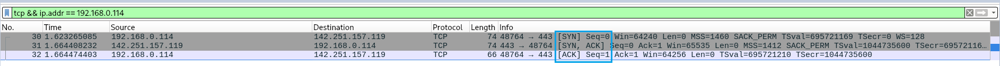
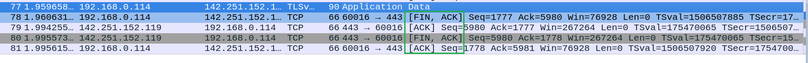

# LAB — Abertura e fechamento de conexão TCP

## Objetivo

Observar o handshake e o encerramento de conexões TCP no Wireshark, compreendendo as flags e os campos Seq, Ack e Len.

## Ambiente

- Sistema operacional: Debian (VM)
- Interface: `enp0s3`
- IP da VM: `192.168.0.114`
- Ferramentas: Wireshark e curl

## Comando executado

Com a captura iniciada, foi executada uma requisição HTTPS usando IPv4:

```bash
curl -4 --http1.1 -I https://www.google.com
```

## Captura no Wireshark

Filtro utilizado para visualizar os dois sentidos da comunicação:

```wireshark
tcp && ip.addr == 192.168.0.114
```

Os prints de abertura e fechamento pertencem a conexões distintas.

### Abertura da conexão



| Pacote | Sentido | Flags | Seq | Ack |
|---|---|---|---|---|
| 30 | Cliente → servidor | SYN | 0 | — |
| 31 | Servidor → cliente | SYN, ACK | 0 | 1 |
| 32 | Cliente → servidor | ACK | 1 | 1 |

O cliente inicia a conexão, o servidor confirma e anuncia sua própria sequência, e o cliente confirma a resposta. Os três segmentos têm `Len=0`, sem dados transportados pelo TCP.

### Fechamento da conexão



| Pacote | Sentido | Flags | Seq | Ack |
|---|---|---|---|---|
| 78 | Cliente → servidor | FIN, ACK | 1777 | 5980 |
| 79 | Servidor → cliente | ACK | 5980 | 1777 |
| 80 | Servidor → cliente | FIN, ACK | 5980 | 1778 |
| 81 | Cliente → servidor | ACK | 1778 | 5981 |

O cliente inicia o fechamento. O pacote 79 confirma dados anteriores, mas ainda não confirma o FIN. No pacote 80, o servidor confirma esse FIN com `Ack=1778` e envia seu próprio FIN. O cliente confirma com `Ack=5981`.

No modelo de quatro vias, cada lado envia um FIN e recebe sua confirmação. Na prática, a confirmação e o FIN podem vir juntos, como no pacote 80. Cada sentido da conexão é encerrado independentemente.

## Minha análise

- **Seq:** posição na sequência de quem envia; em segmentos de dados sem SYN, indica o primeiro byte transportado.
- **Ack:** próxima posição esperada do outro lado, confirmando cumulativamente as posições anteriores recebidas em ordem.
- **Len do TCP:** quantidade de bytes de dados, sem cabeçalhos. Já a coluna **Length** mostra o tamanho do quadro capturado.
- **SYN e FIN** consomem uma posição cada; **ACK sem dados** não consome posição.

O TCP numera bytes, não pacotes. Por exemplo, `Seq=500` com `Len=100` transporta as posições **500 até 599**; recebendo tudo em ordem, o outro lado confirma com `Ack=600`.

Cada lado escolhe seu próprio número de sequência inicial (ISN), usando mecanismos que buscam torná-lo imprevisível, geralmente descritos como pseudoaleatórios. O Wireshark mostra números relativos a partir de zero; os valores reais aparecem em **Sequence Number (raw)**.

No laboratório, um SYN com `Seq (raw)=4000480093` foi confirmado com `Ack (raw)=4000480094`, equivalente a `Seq=0` e `Ack=1` na visualização relativa.

Após o handshake TCP, foi observado o início da negociação TLS. Um envio com `Seq=1` e `Len=1574` foi confirmado em etapas: `Ack=1401` e depois `Ack=1575`. Isso mostra que uma confirmação pode abranger parte dos dados antes de confirmar o total.

## Relação com SOC N1

Compreender a abertura e o fechamento de conexões ajuda a analisar tentativas de comunicação, conexões estabelecidas e encerramentos durante uma investigação.

O analista pode correlacionar **IPs, portas e horários da captura** com logs de firewall, aplicação e alertas do SIEM. Flags, Seq e Ack ajudam a reconstruir a sequência dos eventos.

Um SYN sem resposta ou um encerramento diferente do esperado não comprova um ataque: é necessário considerar o ponto da captura, possíveis perdas, regras de firewall e o contexto do ambiente.
