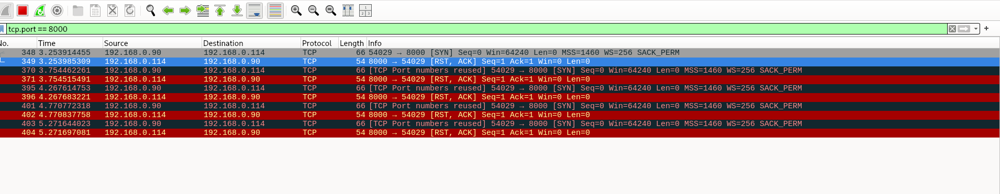
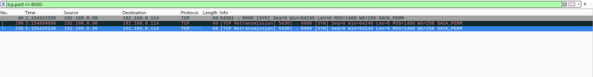

# LAB — Abertura, transferência e fechamento de conexão TCP

## Objetivo

Observar conexões TCP no Wireshark, interpretando flags, Seq, Ack, Len, janela e os efeitos de regras de firewall.

## Ambiente

- Debian (VM): `192.168.0.114`, interface `enp0s3`.
- Windows (cliente do teste HTTP): `192.168.0.90`.
- Ferramentas: Wireshark, curl, servidor HTTP Python e nftables.

## Abertura e fechamento — HTTPS

Com a captura iniciada, foi executada uma requisição HTTPS usando IPv4:

```bash
curl -4 --http1.1 -I https://www.google.com
```

Filtro utilizado:

```wireshark
tcp && ip.addr == 192.168.0.114
```

Os prints de abertura e fechamento pertencem a conexões distintas. O Wireshark exibe números de sequência relativos nas tabelas abaixo.

### Abertura da conexão


| Pacote | Sentido | Flags | Seq | Ack |
|---|---|---|---|---|
| 30 | Cliente → servidor | SYN | 0 | — |
| 31 | Servidor → cliente | SYN, ACK | 0 | 1 |
| 32 | Cliente → servidor | ACK | 1 | 1 |

O cliente inicia a conexão, o servidor confirma e anuncia sua própria sequência, e o cliente confirma a resposta. Os três segmentos têm `Len=0`, sem dados transportados pelo TCP. Depois do handshake, foi observado o início da negociação TLS.

### Fechamento da conexão


| Pacote | Sentido | Flags | Seq | Ack |
|---|---|---|---|---|
| 78 | Cliente → servidor | FIN, ACK | 1777 | 5980 |
| 79 | Servidor → cliente | ACK | 5980 | 1777 |
| 80 | Servidor → cliente | FIN, ACK | 5980 | 1778 |
| 81 | Cliente → servidor | ACK | 1778 | 5981 |

O pacote 79 confirma dados anteriores, mas ainda não confirma o FIN. No pacote 80, o servidor confirma esse FIN com `Ack=1778` e envia seu próprio FIN. O cliente confirma com `Ack=5981`.

Cada sentido é encerrado independentemente. A confirmação e o FIN podem vir no mesmo segmento, como no pacote 80.

## Transferência de dados — HTTP local

No Debian, foi criado um arquivo e iniciado um servidor HTTP:

```bash
mkdir -p /tmp/lab-tcp
cd /tmp/lab-tcp
printf 'Laboratorio TCP - confirmacao de recebimento.\n' > teste.txt
python3 -m http.server 8000 --bind 0.0.0.0
```

No Windows:

```powershell
curl.exe --noproxy "*" --connect-timeout 5 http://192.168.0.114:8000/teste.txt
```

Filtro no Wireshark:

```wireshark
tcp.port == 8000
```

### Seq, Ack e Len

- **Seq:** identifica a posição do primeiro byte de dados no fluxo de quem envia, em segmentos de dados sem SYN. Não é uma posição na memória ou no arquivo.
- **Len:** quantidade de bytes de dados TCP, sem os cabeçalhos TCP, IP e Ethernet. A coluna **Length** mostra o tamanho do quadro capturado.
- **Ack:** próxima posição esperada do outro lado; confirma cumulativamente as posições anteriores recebidas em ordem.
- **SYN e FIN** consomem uma posição cada; **ACK puro**, sem dados, não consome posição.

No pacote 204, o Windows enviou o GET com `Seq (raw)=3957541613` e `Len=91`. Os dados ocuparam as posições **3957541613 a 3957541703**. O Debian confirmou no pacote 205 com `Ack (raw)=3957541704`:

```text
3957541613 + 91 = 3957541704
```

Na numeração relativa: `Seq=1 + Len=91 → Ack=92`. O TCP numera bytes, não pacotes. Cada lado mantém sua própria sequência inicial; os valores absolutos aparecem nos campos **raw** do Wireshark.

Na resposta, o Debian enviou 186 bytes no pacote 206 e 46 no 207. O Windows confirmou os 232 bytes com `Ack=233`. O pacote 207 também levou um FIN, posteriormente confirmado com `Ack=234`.

### Full duplex, piggybacking e PSH

O TCP permite transmissão simultânea nos dois sentidos (**full duplex**). Neste teste houve dados nos dois sentidos, em uma troca de pedido e resposta.

O pacote 206 transportou `Len=186` e `Ack=92`: dados e confirmação no mesmo segmento (**piggybacking**).

**PSH** sinaliza para disponibilizar os dados à aplicação sem esperar mais dados para esse fim. Não indica fim da transmissão; essa função é do **FIN**. Um segmento com `PSH=0` também pode transportar dados e ser disponibilizado imediatamente à aplicação. A flag **ACK=1** indica que o campo de confirmação é válido, não que seu valor seja 1.

### Janela e opções TCP

A janela anunciada informa quanto **quem envia o segmento está disposto a receber**, a partir do ACK indicado. Ela ajuda no controle de fluxo e não representa velocidade nem o Len do segmento.

No anúncio do Debian: `Window=502 × fator 128 = 64256 bytes`, exibidos em **Calculated window size**. Conforme os dados chegam e a aplicação os consome, o espaço disponível pode mudar.

| Opção | Finalidade |
|---|---|
| MSS | Limite de dados TCP por segmento que a ponta anuncia aceitar. `MSS=1460` não obriga cada segmento a ter `Len=1460`. |
| Window Scale | Fator de escala da janela, negociado na abertura. |
| SACK Permitted | Anuncia suporte à confirmação seletiva de blocos recebidos quando há lacunas. |
| Timestamps | Quando presentes, auxiliam na medição do tempo de ida e volta e no tratamento de segmentos antigos. |

MSS e Len se referem aos dados TCP, sem os cabeçalhos TCP/IP. O MSS anunciado por uma ponta limita o envio da outra.

## Porta fechada e regras de firewall

Primeiro, o servidor HTTP foi encerrado e a ausência de listener foi verificada com `ss -lnt 'sport = :8000'`. Depois, o servidor foi reativado para comparar as ações REJECT e DROP do firewall.

| Cenário | Resultado observado |
|---|---|
| Sem serviço escutando na porta 8000 | SYN → RST, ACK |
| Serviço ativo + REJECT com TCP reset | SYN → RST, ACK |
| Serviço ativo + DROP | SYN e retransmissões, sem resposta |
| Serviço ativo após remover a regra | Conexão estabelecida e arquivo recebido |

### Porta sem serviço escutando



A tentativa foi rejeitada antes do estabelecimento da conexão.

### REJECT com TCP reset

Foi criada uma tabela temporária, com bloqueio restrito ao IP do Windows e à porta TCP 8000:

```bash
sudo nft add table inet lab_tcp
sudo nft 'add chain inet lab_tcp entrada { type filter hook input priority -10; policy accept; }'
sudo nft add rule inet lab_tcp entrada ip saddr 192.168.0.90 tcp dport 8000 counter reject with tcp reset
```

A captura mostrou cinco pares SYN → RST, ACK, e a regra contabilizou cinco pacotes. O handshake não se completou e não houve envio do GET. Um `Win=0` no RST não representa o cenário de buffer cheio de uma conexão ativa.

### DROP

A regra anterior foi substituída por descarte silencioso:

```bash
sudo nft flush chain inet lab_tcp entrada
sudo nft add rule inet lab_tcp entrada ip saddr 192.168.0.90 tcp dport 8000 counter drop
sudo nft list table inet lab_tcp
```



Foram observados um SYN inicial e duas retransmissões, sem resposta. O contador registrou três pacotes descartados. O Wireshark na VM capturou os SYNs antes do descarte pelo firewall local; isso não significa que chegaram à aplicação.

Ao final, a tabela de teste foi removida e o acesso HTTP voltou a funcionar:

```bash
sudo nft delete table inet lab_tcp
```

## Conceitos reconhecidos sem simulação específica

- **Zero Window:** o receptor anuncia ausência de espaço para mais dados naquele momento.
- **Window Full:** o segmento atinge o limite da janela anunciada, conforme a análise do Wireshark; sozinho, não indica falha.
- **Retransmission:** reenvio de um segmento; neste laboratório, foi observado com SYNs após o DROP. Pode ocorrer também com dados, por diferentes causas.

## Relação com SOC N1

IPs, portas, horários, flags e confirmações ajudam a reconstruir a comunicação e podem ser correlacionados com logs de firewall, aplicação e alertas do SIEM. Um ACK TCP confirma recebimento pela pilha TCP, não o processamento pela aplicação ou o sucesso de uma autenticação.

**O mesmo padrão pode ter causas diferentes:** RST, ACK pode vir de uma porta fechada ou de rejeição por firewall, inclusive usando o IP do destino. SYNs sem resposta podem envolver descarte, perdas, problemas de rota ou indisponibilidade.

Neste ambiente controlado, os contadores das regras e o retorno do acesso após removê-las complementaram a captura. RST, retransmissões ou ausência de resposta, isoladamente, não comprovam ataque.
