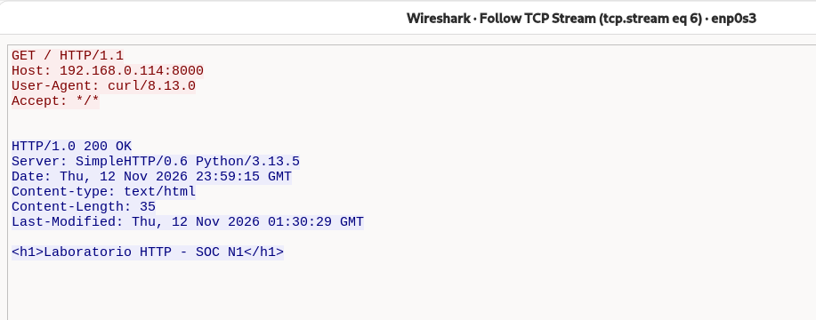
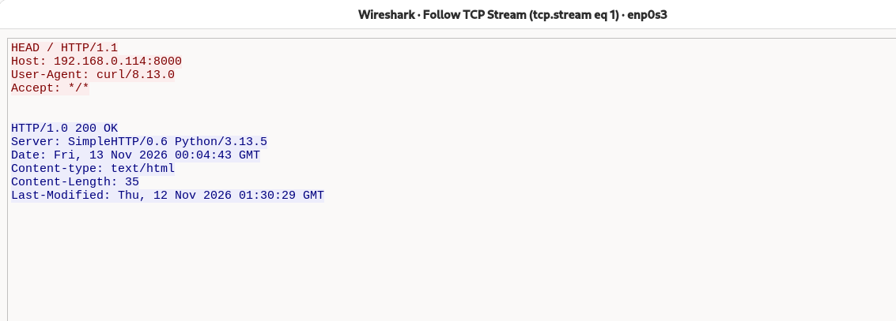
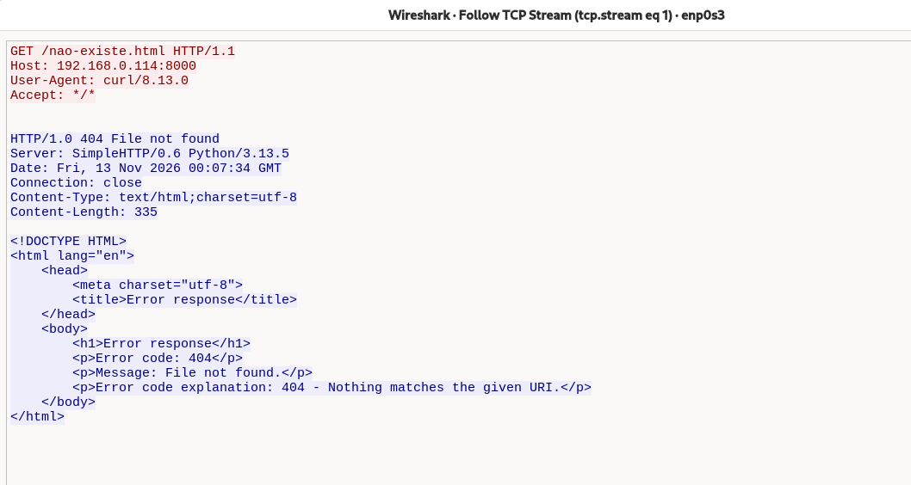
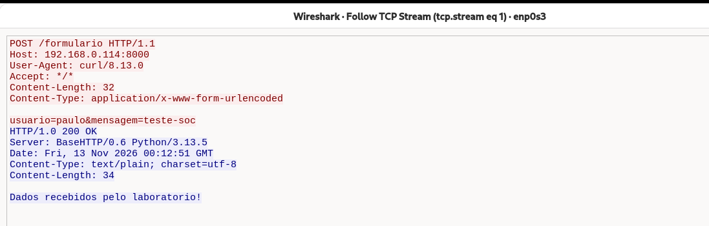
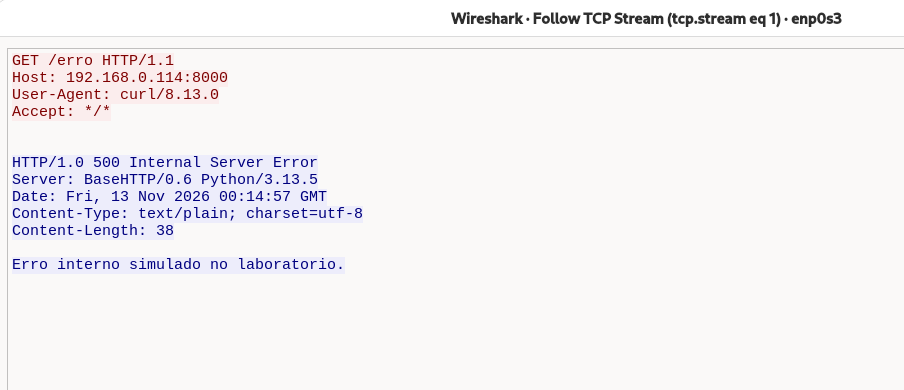
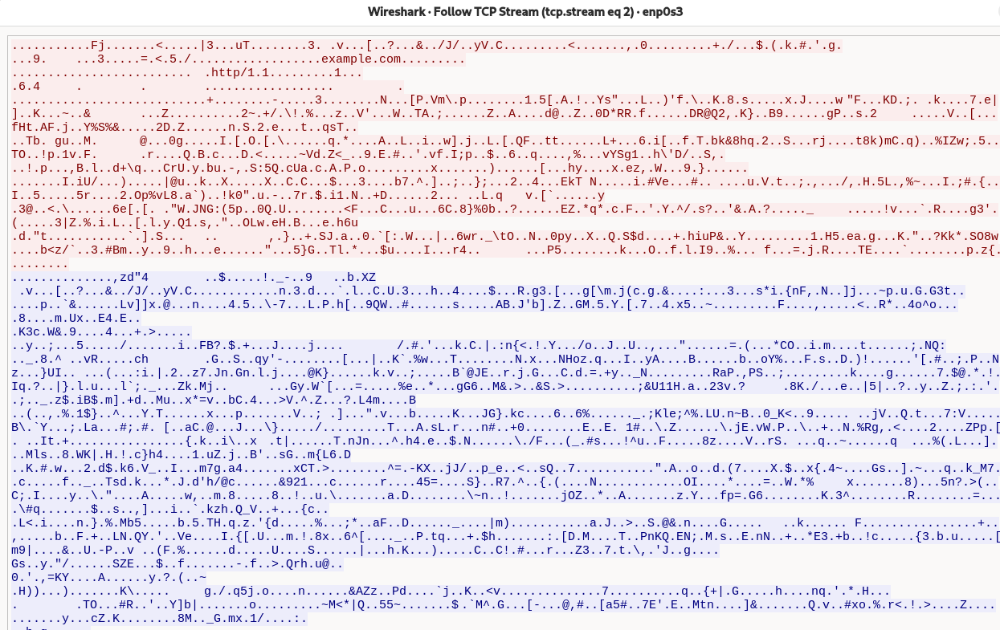

# LAB — HTTP e HTTPS no Wireshark

## Objetivo

Observar os métodos GET, HEAD e POST, os códigos 200, 404 e 500 e a diferença entre HTTP e HTTPS na captura de tráfego.

## Ambiente

- Windows como cliente e VM Debian como servidor HTTP (`192.168.0.114:8000`).
- Ferramentas: curl, servidor Python e Wireshark na interface `enp0s3`.
- Filtros: `tcp.port == 8000` para HTTP e `tcp.port == 443` para HTTPS.
- Análise das mensagens pela opção **Follow → TCP Stream**.

## 1. GET — 200 OK

```powershell
curl.exe --http1.1 -v http://192.168.0.114:8000/
```

Foi realizada uma requisição GET ao servidor local. Foram identificados o caminho solicitado (`/`), a resposta `200 OK`, os cabeçalhos e o corpo HTML. Como usamos HTTP sem criptografia, o conteúdo ficou legível na captura.



## 2. HEAD — resposta sem corpo

```powershell
curl.exe --http1.1 -I http://192.168.0.114:8000/
```

A resposta apresentou os cabeçalhos e o código `200 OK`, sem enviar o corpo HTML. O `Content-Length: 35` indica o tamanho do corpo que seria enviado em um GET.



## 3. GET — 404

```powershell
curl.exe --http1.1 -v http://192.168.0.114:8000/nao-existe.html
```

Foi solicitado um arquivo inexistente. O servidor respondeu com `404` e uma página HTML de erro, mostrando que respostas de erro também podem conter corpo. O cabeçalho `Connection: close` informa o encerramento da conexão após a resposta; não indica falha no handshake.



## 4. POST — envio de dados

```powershell
curl.exe --http1.1 -v -d "usuario=paulo&mensagem=teste-soc" http://192.168.0.114:8000/formulario
```

Foram enviados dados fictícios no corpo da requisição, e o servidor confirmou o recebimento com `200 OK`. A linha em branco separa os cabeçalhos do corpo. Os dados ficaram legíveis: **POST não oferece criptografia**.



## 5. Erro 500 simulado

```powershell
curl.exe --http1.1 -v http://192.168.0.114:8000/erro
```

O servidor do laboratório foi programado para retornar `500 Internal Server Error`. Foram observados os cabeçalhos e a mensagem de erro no corpo. Houve resposta HTTP, diferentemente de uma conexão recusada ou timeout.



## 6. Comparação com HTTPS

Comando executado na VM Debian:

```bash
curl -4 --http1.1 -v https://example.com/
```

O GET continuou existindo, mas o conteúdo HTTP ficou protegido pelo TLS e não apareceu legível na captura sem descriptografia. O domínio `example.com` (SNI) e o anúncio `http/1.1` (ALPN) permaneceram visíveis na negociação TLS.



## Análise SOC N1

- **Frequência e caminhos:** avaliar acessos pontuais ou repetitivos e buscas por caminhos sensíveis, como `/admin`, `/backup.zip` e `/.env`.
- **Origem e contexto:** verificar usuários, ferramentas internas e varreduras autorizadas antes de concluir que existe ataque.
- **404:** investigar se os recursos existem ou foram removidos; links antigos ou quebrados também podem explicar os erros.
- **Outras respostas:** verificar se algum caminho retornou `200` e analisar o conteúdo. Esse código sozinho não confirma exposição nem login bem-sucedido.
- **500:** correlacionar horário, requisições e logs da aplicação; o código isolado não comprova ataque.
- **Criptografia:** HTTP pode expor dados sensíveis. HTTPS protege o conteúdo, mas IPs e portas continuam visíveis, e seu uso não garante um acesso legítimo.
