# LAB — HTTP e HTTPS no Wireshark

## Objetivo

Analisar requisições e respostas HTTP, os métodos GET, HEAD e POST, os códigos de status e a diferença de visibilidade entre HTTP e HTTPS.

## Ambiente

- Cliente: Windows com curl e Debian no teste HTTPS.
- Servidor local: Python na VM Debian, IP `192.168.0.114`, porta `8000`.
- Captura: Wireshark na interface `enp0s3`.

## Testes realizados

Comandos executados no PowerShell, com o servidor correspondente ativo na VM:

```powershell
# GET: cabeçalhos e corpo da página
curl.exe --http1.1 -v http://192.168.0.114:8000/

# HEAD: cabeçalhos da resposta, sem corpo
curl.exe --http1.1 -I http://192.168.0.114:8000/

# Recurso inexistente
curl.exe --http1.1 -v http://192.168.0.114:8000/nao-existe.html

# POST: envio de dados fictícios no corpo
curl.exe --http1.1 -v -d "usuario=paulo&mensagem=teste-soc" http://192.168.0.114:8000/formulario

# Erro interno simulado
curl.exe --http1.1 -v http://192.168.0.114:8000/erro
```

| Teste | Resultado observado |
|---|---|
| GET `/` | `200 OK`, com cabeçalhos e corpo HTML. |
| HEAD `/` | `200 OK`, sem corpo; `Content-Length` informa o tamanho que seria enviado no GET. |
| GET `/nao-existe.html` | `404`, com uma página de erro no corpo. |
| POST `/formulario` | Dados enviados no corpo e resposta `200 OK` confirmando o recebimento. |
| GET `/erro` | `500 Internal Server Error`, retornado propositalmente pelo servidor do laboratório. |

No Wireshark, foi utilizado o filtro `tcp.port == 8000` e a opção **Follow → TCP Stream**. Métodos, caminhos, cabeçalhos e corpos ficaram legíveis. A linha em branco separa os cabeçalhos do corpo. **POST não criptografa os dados.**

## Comparação com HTTPS

Comando executado na VM Debian:

```bash
curl -4 --http1.1 -v https://example.com/
```

Com o filtro `tcp.port == 443`, foram observados o handshake TCP, a negociação TLS 1.3 e registros criptografados. No Follow TCP Stream, o conteúdo HTTP não ficou legível sem as chaves TLS. O GET continuou existindo, mas protegido pela criptografia.

IPs, portas e o domínio `example.com` no SNI permaneceram visíveis. O texto `http/1.1` no Client Hello corresponde ao anúncio de protocolo via ALPN, não à requisição HTTP.

## Análise SOC N1

- **Vários 404:** avaliar frequência, caminhos solicitados, origem e contexto. Links antigos ou quebrados também podem explicar esses erros; verificar se os recursos existem, foram removidos ou deveriam estar disponíveis.
- **Caminhos sensíveis:** acessos a `/admin`, `/backup.zip` ou `/.env` podem justificar investigação, considerando usuários, ferramentas internas e varreduras autorizadas.
- **Outras respostas:** verificar se algum caminho retornou `200` e qual conteúdo foi entregue. O código sozinho não confirma exposição nem autenticação bem-sucedida.
- **Erro 500:** correlacionar horário, requisições e logs da aplicação; o código isolado não comprova ataque. Receber uma resposta HTTP difere de conexão recusada ou timeout.
- **HTTP e HTTPS:** dados sensíveis podem ficar legíveis em HTTP. HTTPS protege o conteúdo, mas não garante que a comunicação seja legítima.

## Evidências

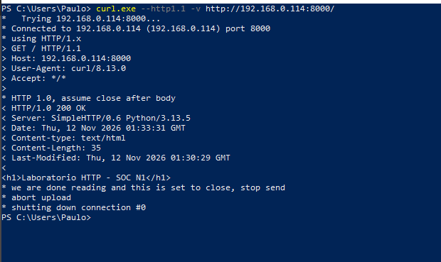

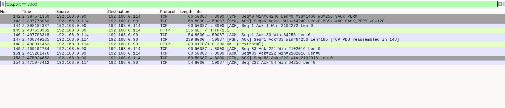

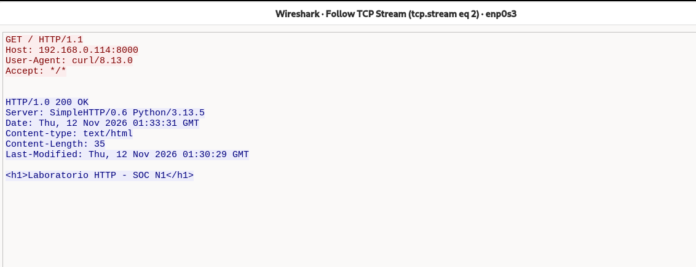

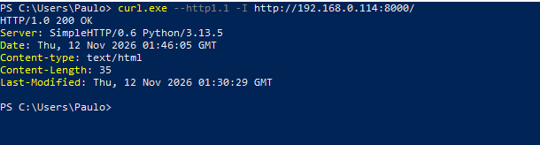

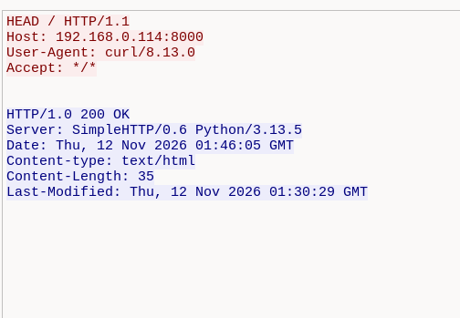

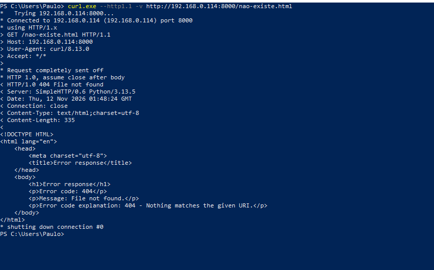

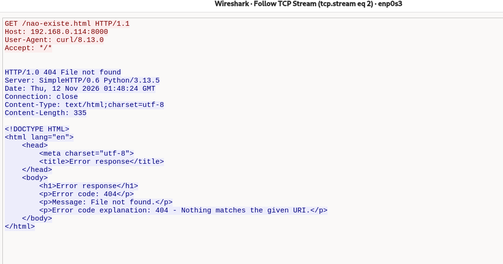

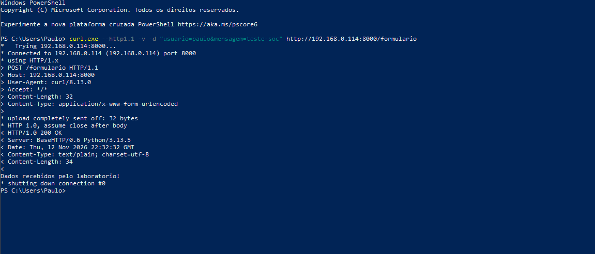

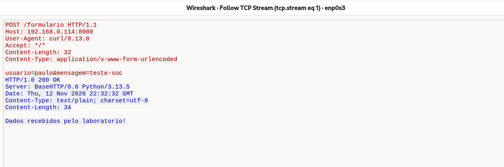

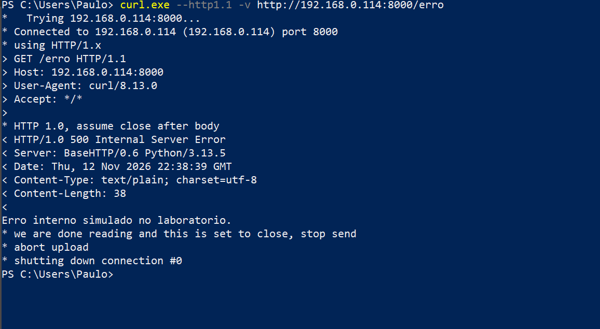

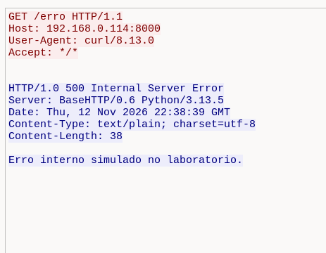

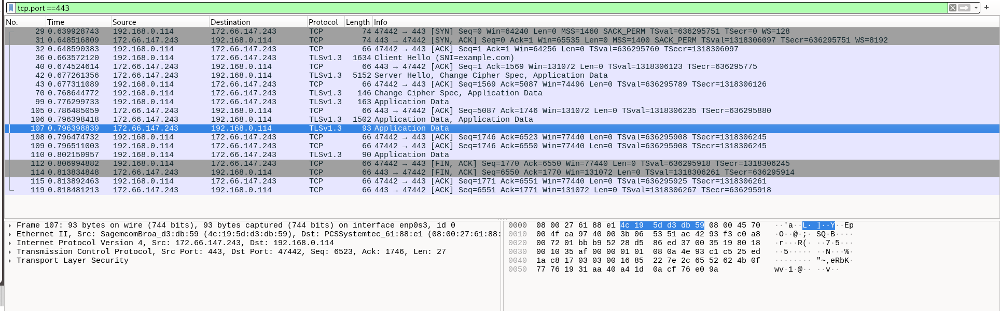

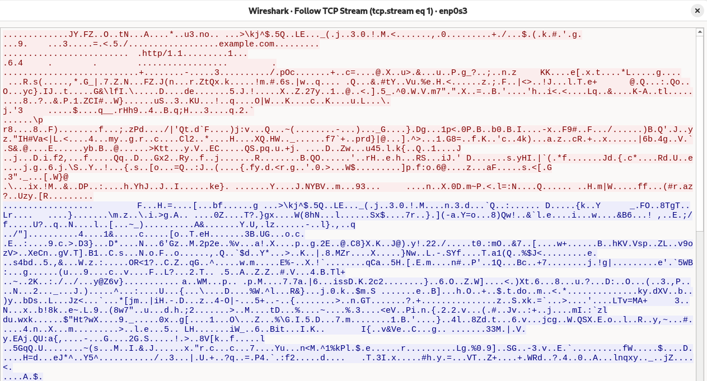
