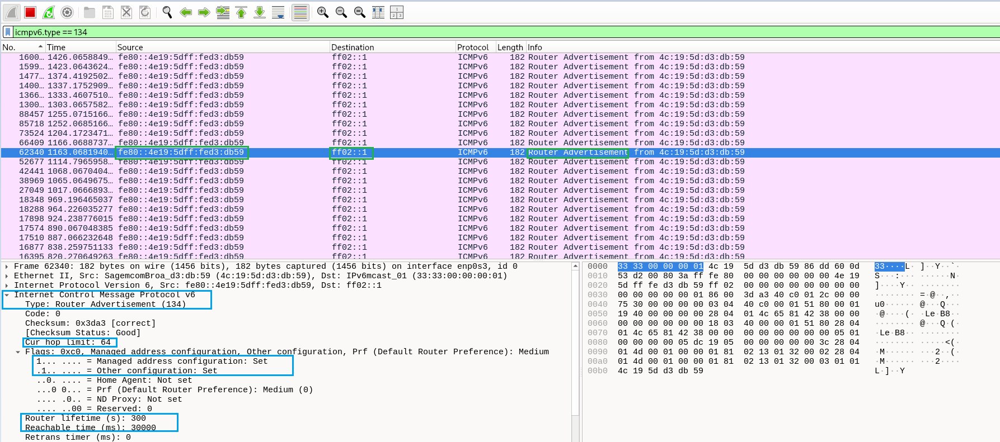
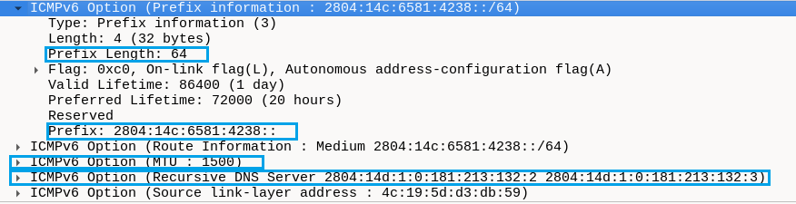

# LAB 02 — Multicast IPv6, Router Solicitation e Router Advertisement

## Objetivo

Analisar o funcionamento do multicast IPv6 e as mensagens **Router Solicitation (RS)** e **Router Advertisement (RA)** utilizando o Wireshark. Correlacionar os anúncios do roteador com a configuração IPv6 da VM Debian e discutir possíveis situações de investigação em um SOC N1.

## Ambiente

- Máquina virtual Debian (VirtualBox)
- Interface de rede: `enp0s3`
- Wireshark para captura de pacotes
- Roteador IPv6 identificado: `fe80::4e19:5dff:fed3:db59`
- Prefixo IPv6 anunciado: `2804:14c:6581:4238::/64`

## 1. Multicast IPv6 e descoberta de roteadores

Diferentemente do IPv4, o IPv6 não utiliza broadcast. Para alcançar grupos de dispositivos, utiliza **multicast**.

| Endereço | Destinatários | Escopo |
|---|---|---|
| `ff02::1` | Todos os nós IPv6 do enlace | Link-local |
| `ff02::2` | Todos os roteadores IPv6 do enlace | Link-local |

No Wireshark, foi utilizado o filtro:

```wireshark
ipv6.dst == ff02::1 || ipv6.dst == ff02::2
```

Foram observadas mensagens **Router Solicitation (ICMPv6 tipo 133)** enviadas pela VM para `ff02::2`. Uma delas apresentou como origem o endereço link-local `fe80::a00:27ff:fe61:88e1`. Também foram observadas RS com origem `::` (endereço não especificado), que pode aparecer antes de a interface dispor de um endereço adequado como origem.

As mensagens **Router Advertisement (ICMPv6 tipo 134)** foram enviadas pelo roteador `fe80::4e19:5dff:fed3:db59` ao grupo `ff02::1`, alcançando os nós IPv6 participantes do enlace.

**Observação:** o roteador pode enviar RA periodicamente, sem depender de uma RS anterior. Portanto, a captura de um RA não comprova, por si só, que ele respondeu a uma RS específica.

### Captura 1 — Router Advertisement e campos principais



No pacote RA analisado, foram identificados:

| Campo | Valor observado | Interpretação |
|---|---|---|
| Source | `fe80::4e19:5dff:fed3:db59` | Endereço link-local do roteador |
| Destination | `ff02::1` | Multicast para todos os nós do enlace |
| ICMPv6 Type | `134` | Router Advertisement |
| Current Hop Limit | `64` | Valor recomendado para o Hop Limit inicial de novos pacotes |
| Flag M | `1` | Indica uso de DHCPv6 para configuração de endereços |
| Flag O | `1` | Indica uso de DHCPv6 para outras informações |
| Router Lifetime | `300 s` | Validade anunciada do roteador como roteador padrão |

O **Current Hop Limit** anunciado no conteúdo do RA não deve ser confundido com o Hop Limit do cabeçalho IPv6 que transporta o próprio anúncio.

As flags M e O indicam o comportamento de configuração sugerido pelo roteador; não comprovam, isoladamente, que um cliente DHCPv6 esteja funcionando ou que determinado endereço tenha sido obtido por DHCPv6.

## 2. Prefix Information e autoconfiguração SLAAC

### Captura 2 — Prefixo, MTU e DNS anunciados



O RA contém a opção **Prefix Information**:

| Campo | Valor observado | Interpretação |
|---|---|---|
| Prefix | `2804:14c:6581:4238::` | Prefixo anunciado |
| Prefix Length | `64` | Primeiros 64 bits do endereço identificam o prefixo |
| Flag L (On-link) | `1` | O prefixo é considerado diretamente alcançável no enlace |
| Flag A (Autonomous) | `1` | O prefixo pode ser usado para autoconfiguração por SLAAC |
| Valid Lifetime | `86400 s` (24 h) | Tempo de validade anunciado para endereços autoconfigurados |
| Preferred Lifetime | `72000 s` (20 h) | Tempo de preferência anunciado para endereços autoconfigurados |

A flag **L = 1** indica que endereços do prefixo podem ser tratados como *on-link*, permitindo tentar comunicação direta com vizinhos do mesmo enlace. Para destinos fora das rotas diretamente alcançáveis, a VM normalmente utiliza o gateway padrão.

A flag **A = 1** indica que o prefixo pode ser utilizado em **SLAAC (Stateless Address Autoconfiguration)**. SLAAC e DHCPv6 podem coexistir na mesma rede.

### Tempos de vida

- **Preferred Lifetime:** quando expira, o endereço pode continuar válido, mas passa a ser *deprecated* (não preferencial), sendo normalmente evitado para novas conexões quando houver alternativa adequada.
- **Valid Lifetime:** quando expira, o endereço deixa de ser válido.
- Novos anúncios válidos podem atualizar esses tempos, respeitando as regras do protocolo.

## 3. Correlação com a VM Debian

### Gateway padrão aprendido via RA

Comando:

```bash
ip -6 route show default
```

Resultado observado:

```text
default via fe80::4e19:5dff:fed3:db59 dev enp0s3 proto ra metric 100 pref medium
```

O gateway padrão corresponde ao endereço de origem do RA. O campo `proto ra` indica que a rota foi aprendida por Router Advertisement.

### Endereços IPv6 e seus tempos de vida

Comando:

```bash
ip -6 addr show dev enp0s3
```

Foram observados os seguintes endereços Global Unicast:

| Endereço | Característica | Valid Lifetime | Preferred Lifetime |
|---|---|---:|---:|
| `2804:14c:6581:4238::18f1/128` | Dinâmico; possível DHCPv6, não confirmado | 2638 s | 2638 s |
| `2804:14c:6581:4238:7e4e:140d:7c0e:9287/64` | Temporário, dinâmico | 86381 s | 14572 s |
| `2804:14c:6581:4238:a00:27ff:fe61:88e1/64` | Dinâmico, IID compatível com EUI-64 modificado | 86381 s | 71981 s |

O último endereço utiliza o mesmo prefixo `/64` anunciado pelo roteador e apresenta tempos de vida próximos aos valores do RA, o que é **consistente com SLAAC**. O endereço temporário possui tempo de preferência próprio, associado a mecanismos de privacidade do IPv6.

**Nota:** a origem exata do endereço `/128` exigiria investigação adicional do cliente DHCPv6; a marcação `dynamic` não é prova suficiente.

### MTU

O RA anunciou **MTU = 1500 bytes**. A interface também apresentou **MTU = 1500** ao executar:

```bash
ip link show dev enp0s3
```

No IPv6, roteadores intermediários não fragmentam pacotes. Se um pacote exceder a MTU do próximo enlace, o roteador pode descartá-lo e enviar **ICMPv6 Packet Too Big (tipo 2)**, permitindo que a origem ajuste o tamanho transmitido.

### Servidores DNS anunciados (RDNSS)

O RA anunciou, na opção **Recursive DNS Server (RDNSS)**:

- `2804:14d:1:0:181:213:132:2`
- `2804:14d:1:0:181:213:132:3`

Comando de verificação:

```bash
cat /etc/resolv.conf
```

Os mesmos endereços foram encontrados na configuração do Debian. Isso confirma a correspondência entre os DNS anunciados e os DNS configurados, **mas não comprova isoladamente que a configuração tenha sido recebida via RA**, pois outros mecanismos, como DHCPv6, também podem fornecer DNS.

## 4. Análise de segurança — perspectiva SOC N1

A presença de mensagens RS e RA na rede é um comportamento normal do IPv6. O sistema operacional pode solicitar informações de roteadores automaticamente, e roteadores podem anunciar periodicamente parâmetros de configuração.

**Situação de investigação:** durante o monitoramento, um analista identifica mensagens RA provenientes de um endereço IPv6 ou MAC desconhecido, anunciando um novo gateway, prefixo ou servidores DNS.

Esse evento **não caracteriza automaticamente um incidente de segurança**. Um novo equipamento pode ter sido instalado legitimamente ou uma alteração autorizada pode ter sido realizada na infraestrutura. Assim como na investigação de um possível servidor DHCP não autorizado, é necessário validar o contexto antes de concluir que há atividade maliciosa.

Procedimento inicial de triagem:

1. Identificar o IPv6 e o MAC de origem do RA e a interface/VLAN em que foi observado.
2. Comparar o roteador, o prefixo, o gateway e os servidores DNS anunciados com a configuração oficial da rede.
3. Consultar a equipe de infraestrutura e os registros de mudança para verificar se houve inclusão ou alteração autorizada.
4. Verificar se dispositivos receberam rotas ou configurações inesperadas e se existem sintomas de indisponibilidade ou redirecionamento de tráfego.
5. Se o anúncio não for autorizado, aprofundar a investigação de possível **Rogue Router Advertisement**, preservando evidências e seguindo o processo de resposta a incidentes.

**Lição principal:** um evento de rede potencialmente suspeito exige contextualização, correlação e validação; não deve ser classificado automaticamente como incidente.

## 5. Conclusão

O laboratório permitiu observar o uso de multicast IPv6 na descoberta de roteadores e analisar mensagens RS/RA no Wireshark. Os anúncios do roteador foram correlacionados com o gateway padrão, os endereços IPv6, a MTU e os servidores DNS configurados no Debian.

Também foi possível compreender a coexistência de **SLAAC e DHCPv6**, as diferenças entre endereços válidos e preferenciais e a importância de validar anúncios inesperados antes de classificá-los como incidentes de segurança.

**Próximo laboratório:** Neighbor Solicitation (NS) e Neighbor Advertisement (NA) — descoberta de vizinhos no IPv6 e comparação com ARP no IPv4.
