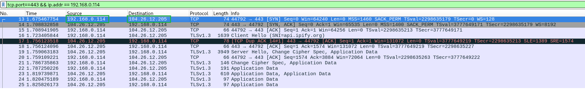

# LAB 5 — Análise de IP privado, IP público e NAT

## Objetivo

Compreender a diferença entre endereços IPv4 públicos e privados, o funcionamento básico do NAT e como os endereços IP aparecem em uma captura de tráfego no Wireshark.

## Ambiente

- Sistema operacional: Debian (VM)
- Interface de rede: `enp0s3`
- IP privado: `192.168.0.114/24`
- Gateway: `192.168.0.1`
- IP público de saída observado: `189.61.44.175`
- Ferramentas: Wireshark e curl

## Comandos executados

Consultar o endereço IPv4 da VM:

```bash
ip -4 addr show enp0s3
```

Consultar o gateway padrão:

```bash
ip route show default
```

Identificar o endereço IPv4 público de saída:

```bash
curl -4 https://api.ipify.org
```

## Captura no Wireshark

Foi utilizado o seguinte filtro:

```text
tcp.port == 443 && ip.addr == 192.168.0.114
```

Durante a captura, foi identificada uma conexão HTTPS com as seguintes informações:

- IP de origem: `192.168.0.114`
- IP de destino: `104.26.12.205`
- Porta de origem: `44792`
- Porta de destino: `443`



## Minha análise

A VM utiliza internamente o endereço IPv4 privado `192.168.0.114`, enquanto o serviço externo identificou o endereço IPv4 público `189.61.44.175`.

Na captura realizada pelo Wireshark, observei que o endereço IP de origem era `192.168.0.114`, e não o endereço público `189.61.44.175`.

### Por que o Wireshark não mostrou o endereço IP público traduzido?

Isso aconteceu porque a captura foi realizada diretamente na interface de rede `enp0s3` da VM Debian, que possui o endereço IP privado `192.168.0.114`.

O Wireshark capturou o pacote **antes de ele passar pelo roteador responsável pelo NAT**, considerando o cenário em que a tradução ocorre nesse equipamento.

Quando o pacote sai da VM, ele ainda utiliza o endereço IP privado como origem. Ao passar pelo roteador, ocorre a tradução NAT, substituindo o endereço privado pelo endereço público utilizado na comunicação com a internet.

Por esse motivo, o Wireshark mostrou o endereço privado: **a captura ocorreu na interface da VM, antes da tradução**.

Se a captura fosse realizada na interface externa do equipamento responsável pelo NAT, após a tradução, seria possível observar o endereço IP de origem já traduzido.

A captura também mostrou o estabelecimento da conexão TCP por meio do *three-way handshake* e a negociação TLS 1.3.

**Observação:** o endereço público retornado pelo serviço externo não comprova, isoladamente, que o NAT ocorreu no roteador local. Em redes com CGNAT, VPN ou proxy, a tradução ou a saída para a internet pode ocorrer em outro equipamento.

## Relação com SOC N1

Durante uma investigação de segurança, o analista pode precisar correlacionar endereços IP privados e públicos para identificar qual dispositivo iniciou determinada conexão.

Em ambientes que utilizam NAT/PAT, essa correlação pode exigir registros contendo endereços IP, portas e horários das conexões.

Compreender em qual ponto da rede uma captura foi realizada também é importante para interpretar corretamente os endereços apresentados no Wireshark.

## Conclusão

O laboratório permitiu compreender o funcionamento básico do NAT e identificar a diferença entre o endereço IPv4 privado utilizado pela VM e o endereço IPv4 público observado por um serviço externo.

Também foi possível entender por que o Wireshark apresentou o endereço privado na captura: o tráfego foi observado na interface de rede da VM, antes de passar pelo ponto de tradução NAT.
