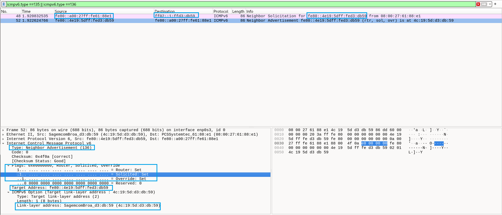

# LAB 03 — NDP: Neighbor Solicitation e Neighbor Advertisement no IPv6

## Objetivo

Capturar e analisar a descoberta de vizinhos no IPv6 por meio do **Neighbor Discovery Protocol (NDP)**, identificando mensagens **Neighbor Solicitation (NS)** e **Neighbor Advertisement (NA)** e comparando esse funcionamento com o ARP do IPv4. Relacionar a captura do Wireshark à tabela de vizinhos do Debian e discutir uma situação de investigação para SOC N1.

## Ambiente

- VM Debian no VirtualBox
- Interface de rede: `enp0s3`
- Wireshark para captura de pacotes
- IPv6 Link-Local da VM: `fe80::a00:27ff:fe61:88e1`
- IPv6 Link-Local do gateway: `fe80::4e19:5dff:fed3:db59`
- MAC do gateway: `4c:19:5d:d3:db:59`

## Contexto teórico

No IPv4, o **ARP** permite descobrir qual endereço MAC está associado a um endereço IPv4 no enlace local. No IPv6, essa função é desempenhada pelo **NDP**, utilizando mensagens **ICMPv6**:

| IPv4 | IPv6 | Função |
|---|---|---|
| ARP Request | Neighbor Solicitation (NS), ICMPv6 tipo 135 | Solicitar a associação IP → MAC |
| ARP Reply | Neighbor Advertisement (NA), ICMPv6 tipo 136 | Anunciar a associação IP → MAC |
| Broadcast Ethernet (na solicitação típica) | Multicast *solicited-node* (na solicitação típica) | Alcançar o vizinho procurado |
| Tabela ARP | Tabela de vizinhos IPv6 | Manter associações entre IP e MAC |

**Observação:** o NDP é mais amplo que o ARP: também inclui descoberta de roteadores (RS/RA), detecção de endereços duplicados e verificação de acessibilidade de vizinhos.

## Procedimento executado

### 1. Consultar a tabela de vizinhos

```bash
ip -6 neigh show dev enp0s3
```

Resultado inicial:

```text
fe80::4e19:5dff:fed3:db59 lladdr 4c:19:5d:d3:db:59 router STALE
```

A VM já conhecia o IPv6 e o MAC do gateway. O estado `STALE` indica que a entrada existe, mas a acessibilidade do vizinho não foi confirmada recentemente; **não significa, isoladamente, falha de rede**.

### 2. Capturar NS e NA no Wireshark

Iniciar uma captura na interface `enp0s3` e aplicar o filtro de exibição:

```wireshark
icmpv6.type == 135 || icmpv6.type == 136
```

### 3. Remover a associação conhecida e gerar comunicação

```bash
sudo ip -6 neigh del fe80::4e19:5dff:fed3:db59 dev enp0s3
ping -6 -c 4 fe80::4e19:5dff:fed3:db59%enp0s3
```

A remoção afeta a entrada da tabela de vizinhos, **não a rota padrão**. O `ping` provoca comunicação com o gateway e permite observar a descoberta de vizinho.

## Evidência — Captura no Wireshark



### Pacote 48 — Neighbor Solicitation (NS)

| Campo | Valor |
|---|---|
| Origem IPv6 | `fe80::a00:27ff:fe61:88e1` (VM) |
| Destino IPv6 | `ff02::1:ff3d:db59` |
| ICMPv6 | Tipo 135 — Neighbor Solicitation |
| Target Address | `fe80::4e19:5dff:fed3:db59` (gateway) |

A VM envia uma solicitação para descobrir o endereço MAC associado ao IPv6 do gateway. O **Destination** é um endereço multicast *solicited-node*, enquanto o **Target Address** identifica o IPv6 que está sendo procurado.

O endereço `ff02::1:ff3d:db59` é derivado dos **últimos 24 bits** do IPv6 alvo (`3d:db59`). O uso desse grupo multicast evita o broadcast típico do ARP no IPv4. Mais de um dispositivo pode participar do mesmo grupo caso os últimos 24 bits coincidam.

### Pacote 52 — Neighbor Advertisement (NA)

| Campo | Valor |
|---|---|
| Origem IPv6 | `fe80::4e19:5dff:fed3:db59` (gateway) |
| Destino IPv6 | `fe80::a00:27ff:fe61:88e1` (VM) |
| ICMPv6 | Tipo 136 — Neighbor Advertisement |
| Target Address | `fe80::4e19:5dff:fed3:db59` |
| Target Link-Layer Address | `4c:19:5d:d3:db:59` |

O gateway respondeu diretamente à VM, anunciando seu MAC na opção **Target Link-Layer Address**. Na captura, as flags do NA estão ativadas:

- **Router:** indica que o emissor se identifica como roteador.
- **Solicited:** indica que o anúncio responde a uma solicitação.
- **Override:** permite a atualização de associações existentes conforme as regras do NDP.

### 4. Confirmar a associação no Debian

```bash
ip -6 neigh show dev enp0s3
```

Após a comunicação, foi confirmado que o MAC associado ao gateway continuava sendo `4c:19:5d:d3:db:59`.

**Resultado:** observamos o ciclo completo de descoberta de vizinho — remoção da entrada, envio de NS, recebimento de NA e reaprendizado da associação IPv6 → MAC.

## Análise de segurança — Possível NDP Spoofing

**Cenário hipotético:** o IPv6 de um gateway passa a ser anunciado por um MAC diferente do registrado anteriormente, especialmente em um intervalo curto.

Isso **pode** indicar NDP Spoofing, tentativa de interceptação de tráfego ou alteração indevida de associações. Entretanto, **não é prova automática de incidente**: troca de equipamento, failover, manutenção ou mudança autorizada também podem explicar o evento.

Como analista SOC N1, as verificações iniciais seriam:

1. Identificar o MAC anunciado e o equipamento/porta de switch associados a ele.
2. Consultar a **CMDB** e o inventário de ativos, reconhecendo que podem estar incompletos.
3. Verificar **CRQs**, janelas de manutenção e mudanças autorizadas.
4. Correlacionar horários dos anúncios com logs de switches, roteadores e eventuais falhas de conectividade.
5. Verificar se outros dispositivos observaram a mesma mudança e se houve alteração inesperada no fluxo de tráfego.
6. Consultar a equipe de redes antes de concluir se a mudança é legítima ou maliciosa.

**Conclusão da triagem:** um MAC diferente ou anúncios frequentes constituem sinais a investigar, mas a classificação como incidente depende do conjunto de evidências. O cenário de spoofing descrito aqui é **hipotético**; não foi observado ataque na captura deste laboratório.

## Relação entre os mecanismos IPv4 e IPv6

Durante os laboratórios, foi possível perceber equivalências funcionais:

- **ARP (IPv4) ↔ NS/NA do NDP (IPv6):** descoberta de endereços MAC associados a endereços IP.
- **DHCPv4 ↔ SLAAC e/ou DHCPv6 (IPv6):** mecanismos de configuração automática de endereços e parâmetros de rede, com funcionamento diferente.
- **RA (IPv6):** anuncia roteadores, prefixos e outras informações; pode ser usado pelo SLAAC. DHCPv6 também pode atuar na mesma rede.

O **NDP não se limita à função equivalente ao ARP**: RS/RA, estudados no LAB 2, também fazem parte do NDP.

## Conclusão

O laboratório demonstrou, por meio do Wireshark e da tabela de vizinhos do Debian, como uma VM IPv6 descobre o endereço MAC de seu gateway utilizando **Neighbor Solicitation** e **Neighbor Advertisement**. A análise também reforçou uma prática essencial para SOC N1: **diferenciar um evento que merece investigação de um incidente confirmado**, correlacionando evidências técnicas e contexto operacional.
