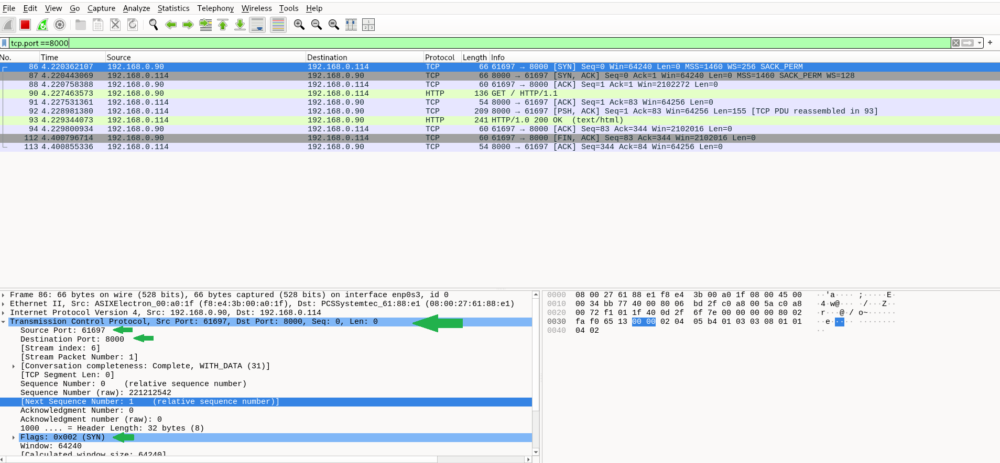
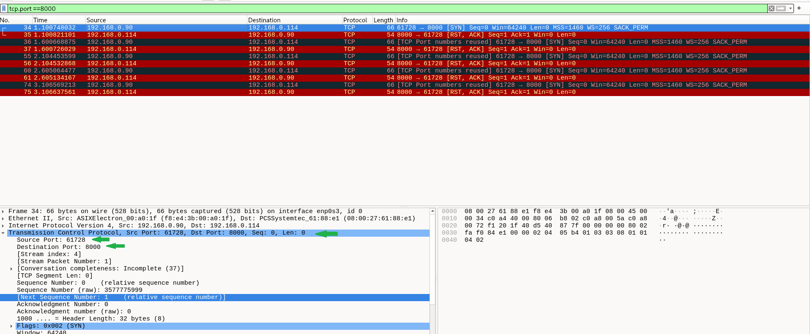

# Laboratório – Portas TCP, processos e análise de conexões

## Objetivo

Relacionar portas TCP aos processos no sistema operacional e analisar, no Wireshark, uma conexão HTTP com o serviço ativo e uma tentativa de conexão após seu encerramento. Exercitar a correlação de evidências aplicada à triagem de SOC N1.

## Ambiente

- Cliente: Windows — `192.168.0.90`.
- Servidor: VM Debian — `192.168.0.114`.
- Interface de captura: `enp0s3`.
- Ferramentas: Wireshark, `ss`, Python 3 e `curl.exe`.
- Serviço de teste: HTTP sobre TCP na porta `8000`.

## Conceitos observados

| Faixa de portas | Classificação |
|---|---|
| 0–1023 | Bem conhecidas ou de sistema |
| 1024–49151 | Registradas ou de usuário |
| 49152–65535 | Dinâmicas ou privadas |

Essas faixas não definem rigidamente o lado cliente ou servidor. Uma aplicação pode ser configurada para escutar em uma porta diferente da padrão. O sistema operacional também possui sua própria configuração para selecionar portas locais automaticamente.

## 1. Levantamento de portas e processos

Na VM, consultei os sockets TCP e UDP em escuta ou aguardando tráfego e seus processos:

```bash
sudo ss -lntup
```

Consultei também a faixa de portas locais automáticas:

```bash
cat /proc/sys/net/ipv4/ip_local_port_range
```

Resultado na VM:

```text
32768 60999
```

Isso demonstra que a faixa configurada no Linux não precisa coincidir com a faixa dinâmica da classificação acima. Essa configuração pertence à VM; as portas do cliente Windows observadas nas capturas foram escolhidas pelo Windows.

## 2. Serviço HTTP ativo

Criei uma pasta para o teste e iniciei o servidor:

```bash
mkdir -p /tmp/lab-portas
python3 -m http.server 8000 --bind 0.0.0.0 --directory /tmp/lab-portas
```

Em outro terminal, confirmei a escuta:

```bash
sudo ss -lntp 'sport = :8000'
```

Foi identificado o processo `python3` em estado `LISTEN`, no endereço `0.0.0.0:8000`. Isso indica escuta em todos os endereços IPv4 locais, mas a acessibilidade pela rede também depende de firewall e roteamento.

Iniciei a captura na interface `enp0s3`, com o filtro de exibição:

```text
tcp.port == 8000
```

No Windows, executei:

```powershell
curl.exe --noproxy "*" -v http://192.168.0.114:8000/
```

### Evidência: conexão aceita



| Pacote | Origem | Destino | Evidência |
|---|---|---|---|
| 86 | `192.168.0.90:61697` | `192.168.0.114:8000` | SYN: cliente inicia a conexão |
| 87 | `192.168.0.114:8000` | `192.168.0.90:61697` | SYN, ACK: servidor responde |
| 88 | `192.168.0.90:61697` | `192.168.0.114:8000` | ACK: cliente conclui o handshake |
| 90 | `192.168.0.90` | `192.168.0.114` | Requisição `GET / HTTP/1.1` |
| 93 | `192.168.0.114` | `192.168.0.90` | Resposta `HTTP/1.0 200 OK` |

A porta `61697` foi a porta efêmera do cliente nesta conexão. A porta `8000` identificou o ponto de escuta do servidor. Nos pacotes de resposta, essas portas aparecem invertidas entre origem e destino.

O handshake estabeleceu a conexão TCP; o GET e a resposta HTTP confirmaram a comunicação na camada de aplicação. O print também mostra um FIN, ACK do cliente no pacote 112 e um ACK do servidor no 113; esses dois pacotes, isoladamente, não mostram todas as etapas de encerramento nas duas direções.

## 3. Serviço HTTP encerrado

Encerrei o servidor Python com `Ctrl+C` e repeti a consulta:

```bash
sudo ss -lntp 'sport = :8000'
```

O comando retornou apenas o cabeçalho, confirmando a ausência de um socket TCP em escuta na porta 8000 no contexto consultado.

Com a captura ativa e o mesmo filtro, repeti a tentativa no Windows:

```powershell
curl.exe --noproxy "*" -v --connect-timeout 5 http://192.168.0.114:8000/
```

### Evidência: conexão recusada



| Pacote | Origem | Destino | Evidência |
|---|---|---|---|
| 34 | `192.168.0.90:61728` | `192.168.0.114:8000` | SYN: tentativa de conexão |
| 35 | `192.168.0.114:8000` | `192.168.0.90:61728` | RST, ACK: conexão recusada |

O padrão se repete nos pares 36/37, 55/56, 60/61 e 74/75. Não houve conclusão do handshake nem troca de mensagens HTTP.

O Wireshark exibiu `TCP Port numbers reused` em SYN posteriores, sinalizando reutilização da mesma combinação de IPs e portas em suas análises de fluxo. Esse aviso, isoladamente, não comprova atividade maliciosa.

## Comparação dos resultados

| Evidência | Serviço ativo | Serviço encerrado |
|---|---|---|
| Consulta com `ss` | Python em `LISTEN` na porta 8000 | Nenhuma escuta na porta 8000 |
| Porta do cliente na captura final | 61697 | 61728 |
| Resposta ao SYN | SYN, ACK | RST, ACK |
| Handshake | Concluído | Não concluído |
| HTTP | GET e resposta 200 OK | Sem troca HTTP |

## Aplicação na análise de SOC N1

- Uma conexão recusada não permite concluir que o servidor está desligado. Neste teste houve uma resposta TCP com endereço de origem da VM.
- Neste laboratório, o encerramento controlado do Python e a consulta com `ss` sustentam a conclusão de que a recusa ocorreu pela ausência do serviço em escuta. Em outro ambiente, um firewall configurado para rejeitar com TCP reset também pode produzir RST.
- O número da porta é uma pista, mas não comprova a aplicação. Neste teste, HTTP funcionou na porta 8000, e sua identificação foi sustentada pelas mensagens HTTP capturadas e pelo processo executado.
- A análise deve correlacionar IPs, portas, flags, protocolo observado, processos, logs e comportamento esperado do ambiente antes de atribuir uma causa ou classificar um incidente.

## Conclusão

O laboratório demonstrou a relação entre processo, porta de escuta e tráfego de rede, além da diferença entre uma conexão TCP aceita e uma tentativa recusada. A comparação reforçou a importância de separar evidências observadas de hipóteses sobre a causa.
