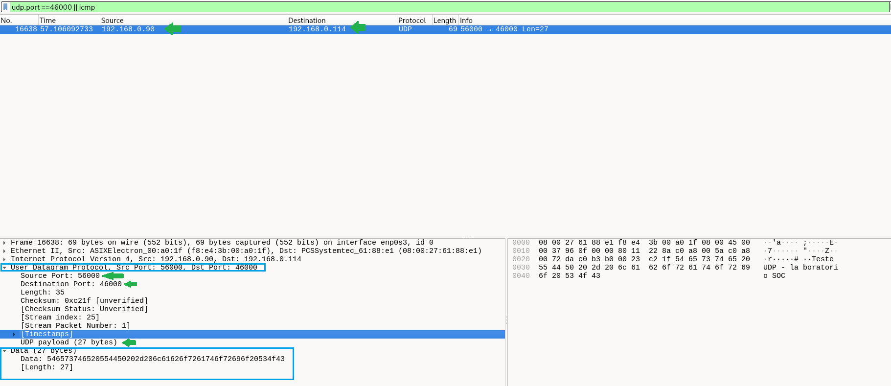
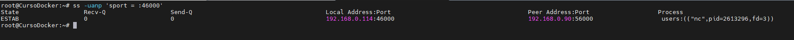
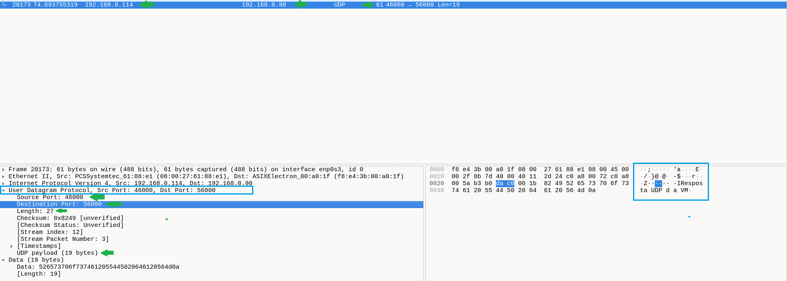
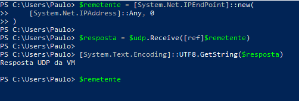

# Laboratório – Análise de UDP no Wireshark

## Objetivo

Observar a estrutura do UDP, trocar mensagens entre Windows e Linux e correlacionar os datagramas capturados com o socket da aplicação. Identificar conteúdo sem criptografia e interpretar erros considerando o contexto, como em uma triagem SOC N1.

## Resumo teórico

O UDP (User Datagram Protocol) é um protocolo da camada de transporte. Envia datagramas sem estabelecer previamente uma conexão: não utiliza handshake e não fornece confirmação de entrega, retransmissão ou ordenação. Datagramas podem ser perdidos, duplicados ou chegar fora de ordem. A aplicação pode implementar controles adicionais.

Seu cabeçalho pequeno e seus poucos mecanismos de controle reduzem a sobrecarga, mas não garantem desempenho superior ao TCP em toda situação.

Exemplos de uso incluem DNS, DHCP, RIP, jogos e aplicações de áudio e vídeo em tempo real. DNS também pode usar TCP; nem todo streaming utiliza UDP.

### Cabeçalho UDP

| Campo | Tamanho | Função |
|---|---|---|
| Porta de origem | 2 bytes | Identifica a porta do remetente |
| Porta de destino | 2 bytes | Identifica a porta do destinatário |
| Comprimento | 2 bytes | Tamanho do cabeçalho UDP mais os dados |
| Checksum | 2 bytes | Permite detectar erros nas informações cobertas pelo cálculo |

O cabeçalho tem **8 bytes**; os dados possuem tamanho variável.

O checksum cobre cabeçalho UDP, dados e um pseudocabeçalho com informações IP. Esse pseudocabeçalho não é transmitido como um cabeçalho adicional. No IPv4, checksum UDP igual a zero indica que não foi utilizado; se o cálculo resultar em zero, transmite-se `0xFFFF`. No IPv6, seu uso é obrigatório como regra geral. Checksum não fornece criptografia nem autenticidade.

No Wireshark, **unverified** significa que o checksum não foi verificado; não significa que esteja incorreto ou ausente.

## Ambiente

| Componente | Configuração |
|---|---|
| Hospedeiro Windows | `192.168.0.90`, PowerShell |
| VM Debian | `192.168.0.114`, interface `enp0s3` |
| Receptor Linux | Netcat tradicional, versão informada `1.10-50` |
| Porta UDP na VM | `46000` |
| Porta UDP no Windows | `56000` |
| Captura | Wireshark na VM |

## 1. Criar o receptor na VM

```bash
nc -u -l -p 46000
```

As opções selecionam UDP (`-u`), modo de recepção (`-l`) e porta local (`-p`). Nesta versão do Netcat, a opção `-p` é necessária.

Em outro terminal:

```bash
ss -uanp 'sport = :46000'
```

Antes do envio, foi observado `UNCONN`, com endereço local `0.0.0.0:46000` e peer `0.0.0.0:*`. O socket estava vinculado à porta nos endereços IPv4 locais, sem um remetente específico associado.

## 2. Capturar e enviar do Windows para a VM

Com a captura iniciada na `enp0s3`, aplicar o filtro de exibição:

```wireshark
udp.port == 46000 || icmp
```

No PowerShell, executar uma vez e manter o socket aberto:

```powershell
$udp = [System.Net.Sockets.UdpClient]::new(56000)
$destino = [System.Net.IPEndPoint]::new(
    [System.Net.IPAddress]::Parse("192.168.0.114"),
    46000
)
$dados = [System.Text.Encoding]::UTF8.GetBytes("Teste UDP - laboratorio SOC")
$udp.Send($dados, $dados.Length, $destino)
```

O valor retornado por `Send()` informa a quantidade de bytes enviada pelo socket; sozinho, não comprova entrega à aplicação remota.

### Resultado da captura

| Campo | Valor |
|---|---|
| Origem | `192.168.0.90:56000` |
| Destino | `192.168.0.114:46000` |
| Payload | 27 bytes |
| Comprimento UDP | 35 bytes: 8 de cabeçalho + 27 de dados |
| Quadro capturado | 69 bytes: Ethernet 14 + IPv4 20 + UDP 8 + dados 27 |
| Checksum UDP | `0xc21f`, unverified |

O datagrama foi enviado diretamente, sem handshake. A mensagem foi recebida no terminal do Netcat.



## 3. Correlacionar com o socket Linux

Repetir a consulta no segundo terminal:

```bash
ss -uanp 'sport = :46000'
```

Após o recebimento, o Netcat apresentou endereço local `192.168.0.114:46000`, peer `192.168.0.90:56000` e estado `ESTAB`.

Neste Netcat, o socket UDP foi associado ao remetente. **ESTAB não significa que houve handshake UDP**: é um estado local do socket. Esse comportamento do programa não deve ser generalizado para toda aplicação UDP.

A opção `-a` mostra todos os sockets UDP; usar somente `-l` pode omitir um socket que já foi associado a um peer.



## 4. Responder da VM para o Windows

No mesmo PowerShell, aguardar uma mensagem usando o socket ainda aberto:

```powershell
$remetente = [System.Net.IPEndPoint]::new(
    [System.Net.IPAddress]::Any, 0
)
$resposta = $udp.Receive([ref]$remetente)
[System.Text.Encoding]::UTF8.GetString($resposta)
$remetente
```

O comando `Receive()` aguarda a chegada do datagrama. No terminal do Netcat, digitar e pressionar Enter:

```text
Resposta UDP da VM
```

### Resultado da captura

| Campo | Valor |
|---|---|
| Origem | `192.168.0.114:46000` |
| Destino | `192.168.0.90:56000` |
| Payload | 19 bytes, incluindo a quebra de linha enviada pelo terminal |
| Comprimento UDP | 27 bytes: 8 de cabeçalho + 19 de dados |
| Quadro capturado | 61 bytes |
| Checksum UDP | `0x8249`, unverified |

As portas e os endereços se inverteram. A resposta foi produzida pela aplicação, a partir do texto digitado; **não foi um ACK automático do UDP**.



O PowerShell exibiu a mensagem recebida:



## 5. Conteúdo sem criptografia

Foi possível ler os textos no painel de bytes do Wireshark porque a aplicação enviou texto sem criptografia. A representação hexadecimal dos bytes não é criptografia.

O UDP não fornece criptografia por si só. Aplicações podem proteger dados transportados por UDP, por exemplo usando DTLS ou QUIC. Da mesma forma, TCP sozinho também não criptografa dados.

No Wireshark, selecionar um datagrama e usar **Follow → UDP Stream**, com exibição em texto, permite visualizar a conversa de forma mais organizada. Outras ferramentas, como TShark e tcpdump, também permitem inspecionar payloads capturados. A interpretação depende do formato dos dados e de a ferramenta ter acesso ao tráfego; ausência de criptografia não significa que todo conteúdo será texto legível.

**Relação com SOC:** conteúdo sensível em texto claro merece avaliação conforme os dados envolvidos e a política da organização. A visibilidade também depende do ponto de captura: estar na mesma rede não garante acesso a todo tráfego unicast de outros dispositivos.

## 6. Testes complementares realizados na sessão

### DNS sobre UDP

Uma consulta de `192.168.0.114:55104` foi enviada ao DNS configurado `181.213.132.2:53`, buscando o registro A de `example.com`. A resposta inverteu endereços e portas e manteve o identificador DNS `0x9697`.

A consulta tinha 52 bytes de payload e comprimento UDP de 60 bytes; a resposta tinha 72 bytes de payload e comprimento UDP de 80 bytes. A resposta DNS pertence à camada de aplicação, não é confirmação própria do UDP.

### Porta sem receptor

Em uma execução anterior, na porta `45678`, o Netcat foi encerrado antes de um novo envio. A VM respondeu com **ICMP Destination unreachable — Port unreachable**. Neste cenário controlado, o receptor havia sido encerrado; a máquina continuava acessível.

Em uma investigação real, essa resposta deve ser correlacionada com sockets, processos e regras de firewall. A ausência de resposta, por sua vez, não comprova que a porta esteja aberta nem que a máquina esteja desligada.

### Broadcast na porta 9999

Na tentativa inicial, a captura revelou tráfego de `192.168.0.111` para `255.255.255.255:9999`, identificado pelo Wireshark como TP-Link, com comandos `get_sysinfo` e `get_realtime`.

O `ss` mostrou o Netcat associado a `192.168.0.111:39792`. Isso interferiu na recepção do envio de outro remetente. O conteúdo era compatível com descoberta ou consulta de dispositivos, mas não identificamos definitivamente o aparelho ou aplicativo responsável. O tráfego isolado não foi suficiente para classificá-lo como incidente.

Esses testes complementares ocorreram antes da repetição documentada nas imagens acima; as portas e evidências não devem ser confundidas.

## Encerramento

Ao finalizar, interromper o Netcat com `Ctrl+C` e fechar o socket do Windows:

```powershell
$udp.Close()
```

## Aprendizados para análise SOC N1

- Correlacionar IPs, portas, direção, payload e processo responsável.
- Separar envio observado na rede de entrega comprovada na aplicação.
- Distinguir resposta da aplicação, estado local do socket e erro ICMP.
- Verificar o contexto antes de atribuir uma falha a firewall, serviço ou indisponibilidade da máquina.
- Reconhecer exposição de conteúdo sem criptografia e os limites do ponto de captura.

O laboratório demonstrou troca de mensagens UDP nos dois sentidos, sem handshake ou confirmação própria do transporte, e a importância de combinar captura de rede com evidências do sistema operacional.
