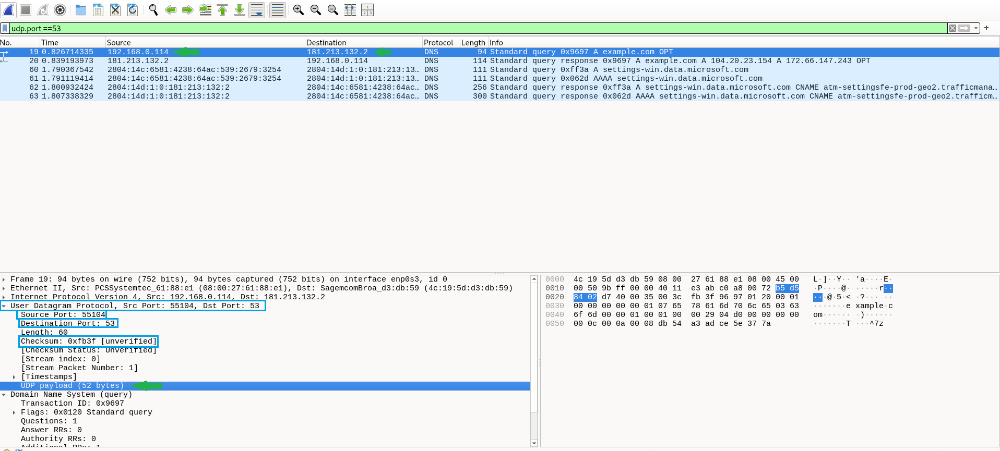
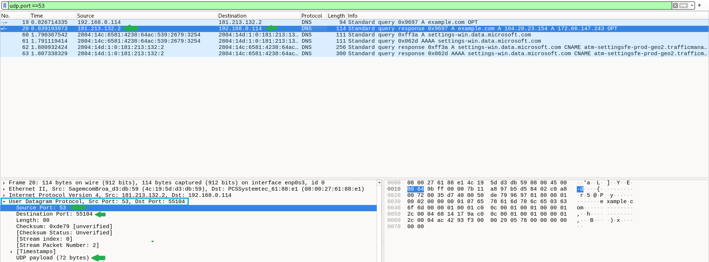

# Laboratório — Análise do protocolo UDP no Wireshark

## Objetivo

Capturar e analisar datagramas UDP em consultas DNS e na troca de mensagens entre Windows e Linux. Identificar portas, cabeçalho e payload, relacionando as evidências com a análise de tráfego em um SOC N1.

## Ambiente

- VM Debian: `192.168.0.114`, interface `enp0s3`.
- Hospedeiro Windows: `192.168.0.90`.
- Servidor DNS consultado: `181.213.132.2`.
- Ferramentas: Wireshark, Netcat tradicional e PowerShell.
- Portas da troca de mensagens: `46000` na VM e `56000` no Windows.

## Resumo sobre UDP

O UDP (User Datagram Protocol) pertence à camada de transporte. Envia datagramas **sem estabelecer conexão previamente** e não fornece confirmação de entrega, retransmissão ou ordenação. A aplicação pode implementar controles adicionais.

Seu cabeçalho tem **8 bytes**, com quatro campos de 2 bytes: porta de origem, porta de destino, comprimento e checksum. O comprimento UDP inclui cabeçalho e dados. A menor sobrecarga não garante que seja sempre mais rápido que o TCP.

DNS, DHCP e aplicações de tempo real são exemplos de uso. DNS também pode utilizar TCP.

## Captura DNS sobre UDP

Na captura, utilizei o filtro de exibição:

```wireshark
udp.port == 53
```

### Evidência 1 — Consulta DNS



No pacote **19**, identifiquei uma consulta pelo registro **A** de `example.com`, enviada pela VM ao servidor DNS configurado.

| Campo | Valor observado |
|---|---|
| Origem | `192.168.0.114:55104` |
| Destino | `181.213.132.2:53` |
| Identificador DNS | `0x9697` |
| Payload UDP | 52 bytes |
| Comprimento UDP | 60 bytes: 8 de cabeçalho + 52 de dados |
| Checksum UDP | `0xfb3f [unverified]` |

**Minha análise:** a porta temporária `55104` identificou o lado cliente, enquanto a consulta foi direcionada à porta `53` do servidor. O destino observado correspondia ao DNS configurado na máquina.

O estado **unverified** significa que o Wireshark não verificou o checksum; não indica, por si só, erro ou ausência desse campo. O checksum detecta possíveis erros, mas não fornece autenticidade ou criptografia. No IPv4, seu uso é opcional; no IPv6, é obrigatório como regra geral.

### Evidência 2 — Resposta DNS



No pacote **20**, o servidor respondeu de `181.213.132.2:53` para `192.168.0.114:55104`, invertendo os endereços e as portas. A resposta manteve o identificador DNS `0x9697` e apresentou os registros A `104.20.23.154` e `172.66.147.243`.

O payload passou para **72 bytes**, e o comprimento UDP para **80 bytes**. O cabeçalho permaneceu com 8 bytes; o que aumentou foi a mensagem DNS transportada.

**Minha análise:** a resposta pertence ao DNS, na camada de aplicação. Ela não representa um ACK fornecido pelo UDP.

## Troca de mensagens entre Windows e Linux

Na VM, utilizei o Netcat como receptor UDP:

```bash
nc -u -l -p 46000
```

A consulta abaixo permitiu observar o socket e o processo responsável:

```bash
ss -uanp 'sport = :46000'
```

Antes do recebimento, o socket aparecia como `UNCONN`, vinculado a `0.0.0.0:46000`. Depois, o Netcat tradicional mostrou `ESTAB`, associado a `192.168.0.90:56000`. **Esse estado indica uma associação local do socket ao remetente, sem handshake UDP.**

Para analisar a comunicação, utilizei o filtro de exibição:

```wireshark
udp.port == 46000 || icmp
```

O filtro inclui também mensagens ICMP, que precisam ser correlacionadas com a comunicação investigada.

### Evidência 3 — Mensagem enviada pelo Windows


O Windows enviou `Teste UDP - laboratorio SOC` diretamente para a VM. A mensagem foi exibida no terminal do Netcat.

| Campo | Valor observado |
|---|---|
| Origem | `192.168.0.90:56000` |
| Destino | `192.168.0.114:46000` |
| Payload UDP | 27 bytes |
| Comprimento UDP | 35 bytes: 8 de cabeçalho + 27 de dados |
| Checksum UDP | `0xc21f [unverified]` |

**Minha análise:** o envio ocorreu sem handshake. A captura mostrou o datagrama na rede, enquanto o texto no terminal confirmou sua entrega à aplicação neste teste.

### Evidência 4 — Resposta enviada pela VM


A VM enviou `Resposta UDP da VM` para o socket mantido aberto no Windows.

| Campo | Valor observado |
|---|---|
| Origem | `192.168.0.114:46000` |
| Destino | `192.168.0.90:56000` |
| Payload UDP | 19 bytes, incluindo a quebra de linha |
| Comprimento UDP | 27 bytes: 8 de cabeçalho + 19 de dados |

Os endereços e as portas se inverteram. A resposta foi produzida pelo texto digitado no Netcat, **não por um ACK automático do UDP**.

### Evidência 5 — Recebimento no Windows


O PowerShell exibiu a mensagem enviada pela VM, confirmando a troca de dados nos dois sentidos.

## Conteúdo sem criptografia

Foi possível ler as mensagens no painel de bytes do Wireshark porque a aplicação enviou texto sem criptografia. **Hexadecimal é uma representação dos bytes, não uma forma de criptografia.**

O UDP não fornece criptografia por si só. Outras ferramentas de captura também podem exibir o payload quando têm acesso ao tráfego. No Wireshark, **Follow → UDP Stream** permite organizar a visualização da conversa. A legibilidade depende do formato dos dados e da proteção utilizada pela aplicação.

## Relação com SOC N1

- **DNS esperado:** comparar o servidor consultado com a configuração e o inventário ajuda a identificar divergências. Um DNS diferente exige validação do contexto antes de classificar um incidente.
- **Correlação de evidências:** IPs, portas, direção, payload, sockets e processos ajudam a explicar o comportamento observado.
- **Texto claro:** conteúdo sensível sem criptografia merece avaliação conforme os dados envolvidos e as políticas da organização.
- **Erros ICMP:** em um teste complementar, após encerrar o Netcat na porta `45678`, a VM respondeu com **Destination unreachable — Port unreachable**. A máquina continuava acessível; naquele cenário controlado, o receptor havia sido encerrado. Em uma investigação real, também seria necessário verificar sockets e firewall.

## Conclusão

Neste laboratório, identifiquei a estrutura do UDP em consultas DNS e na troca de mensagens entre Windows e Linux. Observei a inversão dos endereços e das portas, a ausência de handshake e a diferença entre resposta da aplicação e confirmação de transporte.

Também relacionei o tráfego com os sockets e confirmei que mensagens enviadas sem criptografia podem ficar legíveis na captura, reforçando a importância de interpretar as evidências dentro do contexto.
