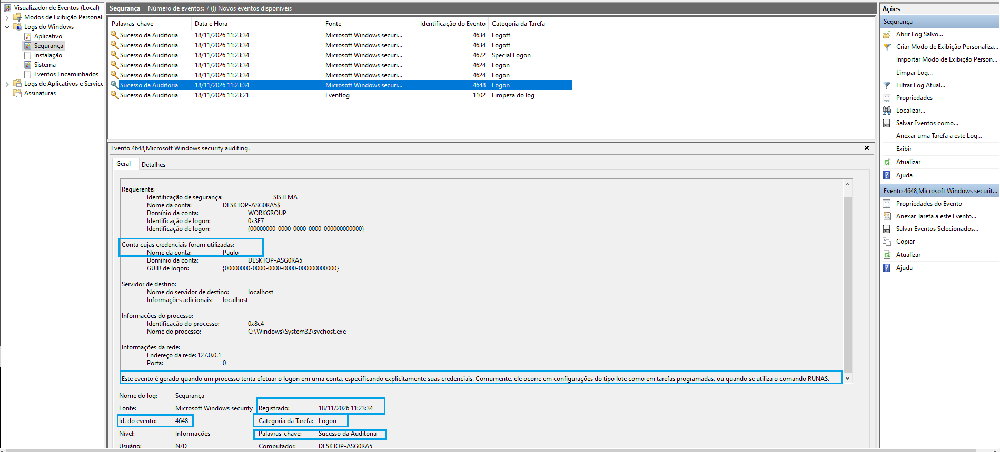
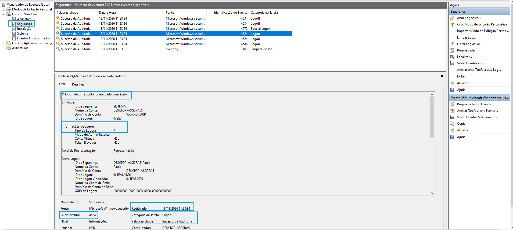
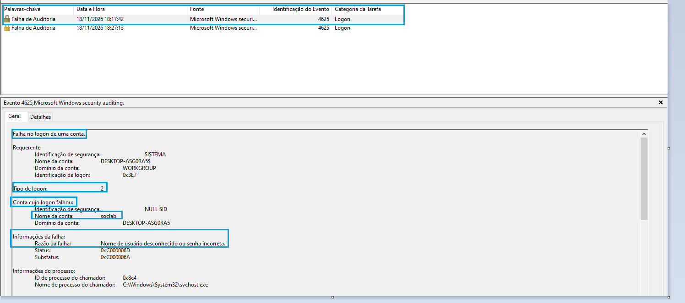
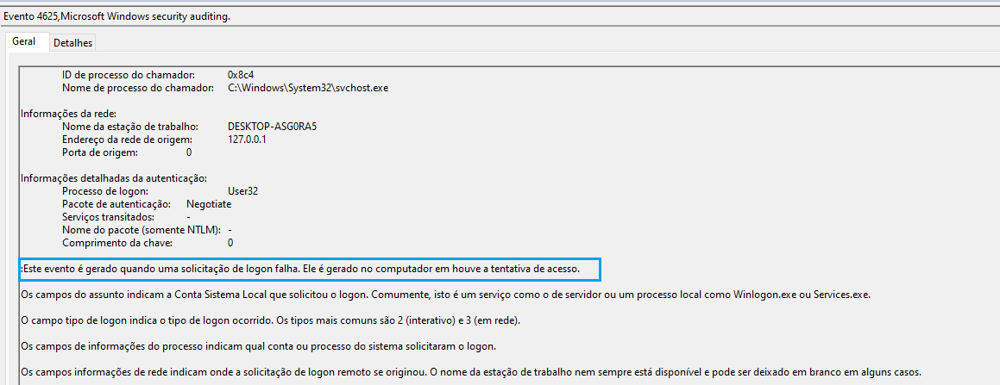

# LAB — Auditoria de logon no Visualizador de Eventos do Windows

## Objetivo

Analisar no log de Segurança o desbloqueio bem-sucedido de uma estação Windows e uma tentativa de logon interativo malsucedida. O laboratório faz parte do portfólio de SOC N1.

## Ambiente

- Sistema operacional: Windows 10 Home Single Language
- Ferramenta: Visualizador de Eventos → Logs do Windows → Segurança
- Contas usadas: `Paulo` (administrador local) e `soclab` (conta local de teste)
- Data: 18/11/2026

## Etapa 1 — Desbloqueio bem-sucedido

1. Limpei o log de Segurança antes do teste. A limpeza gerou o evento `1102` às 11:23:21.
2. Bloqueei a estação com `Win + L` e digitei a senha correta da conta `Paulo` para desbloquear a sessão.
3. Voltei ao Visualizador de Eventos e examinei diretamente os registros das 11:23:34 no canal Segurança. **Nesta etapa, não usei filtros.**

### Evento 4648 — Tentativa de logon com credenciais explícitas

O evento mostra que o processo `svchost.exe`, sob `SISTEMA`, tentou efetuar um logon usando as credenciais da conta `Paulo`. O destino era `localhost` e o endereço registrado era `127.0.0.1`. O recorte destaca a explicação do próprio Visualizador de Eventos e o campo **Conta cujas credenciais foram utilizadas**.

### Evento 4624 — Logon bem-sucedido, tipo 7

O `4624` registra o êxito do logon. O **tipo de logon 7** indica que a estação foi desbloqueada. Em **Novo Logon**, a conta é `Paulo`. O print mostra a sessão com **Token Elevado: Não**.

### Correlação dos registros

O `4648` e o `4624` analisados foram registrados às **11:23:34**. A conta usada, o horário e o PID `0x8c4` do processo `svchost.exe` ajudaram a relacionar a tentativa com o desbloqueio bem-sucedido. O rótulo **Sucesso da Auditoria** no `4648` diz respeito ao registro da tentativa. O êxito do logon foi observado no `4624`.

Os dois eventos `4624` da conta `Paulo` tinham vínculos recíprocos:

| ID de Logon | ID de Logon Vinculado | Tipo de Logon | Token Elevado |
|---|---|---|---|
| `0x1EA84599` | `0x1EA845C6` | 7 | Sim |
| `0x1EA845C6` | `0x1EA84599` | 7 | Não |

## Etapa 2 — Tentativa de logon malsucedida

1. Digitei uma senha incorreta para a conta local de teste `soclab`.
2. No canal **Segurança**, usei **Filtrar Log Atual** com dois critérios: **o horário do teste** e o **ID do evento `4625`**.
3. Analisei o registro das **18:17:42 de 18/11/2026**, marcado como **Falha de Auditoria**.

| Campo | Valor observado | Interpretação |
|---|---|---|
| ID do Evento | `4625` | Uma tentativa de logon falhou. |
| Tipo de Logon | `2` | Logon interativo. |
| Conta cujo logon falhou | `soclab` | Conta local usada no teste. |
| Razão da falha | Nome de usuário desconhecido ou senha incorreta | Mensagem geral exibida pelo Windows. |
| Status / Substatus | `0xC000006D` / `0xC000006A` | O status indica falha de logon. O substatus indica senha incorreta. |
| Endereço de origem | `127.0.0.1` | A tentativa partiu da própria estação. |

A mensagem de falha apresenta duas causas possíveis. Na triagem, o **Substatus** permite identificar a senha incorreta, o que corresponde ao teste realizado. [Documentação do evento 4625 — Microsoft Learn](https://learn.microsoft.com/windows/security/threat-protection/auditing/event-4625)

## Conclusão — Como ler o ID do evento

O **ID do Evento** é o código que identifica o que um provedor registrou, como uma ação, uma tentativa ou seu resultado. No provedor `Microsoft-Windows-Security-Auditing`, o `4648` registra uma tentativa com credenciais explícitas, o `4624` registra o êxito do logon e o `4625` registra uma falha de logon.

Os detalhes completam a triagem. Neste lab, o **tipo 7** identificou o desbloqueio no `4624`, enquanto o **tipo 2** identificou a tentativa interativa no `4625`. A conta, o horário, a origem e o substatus ajudaram a explicar cada registro.
