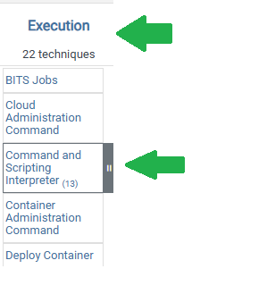
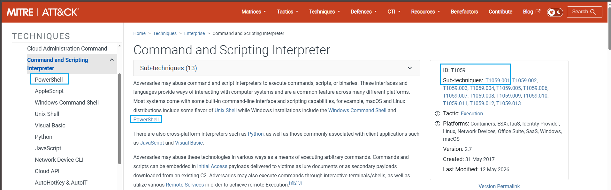
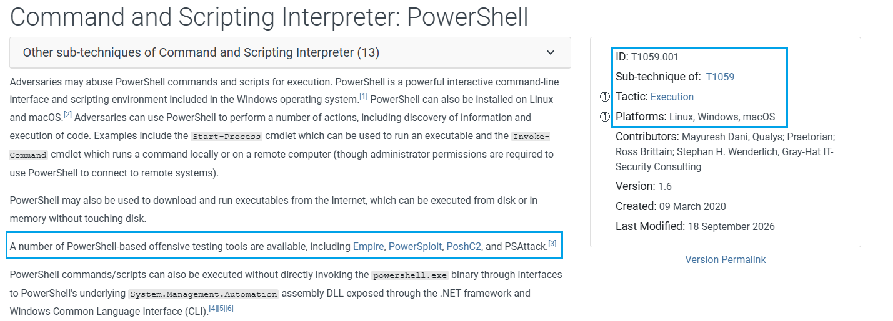

# LAB — Investigação de PowerShell com MITRE ATT&CK

## Objetivo

Analisar um evento suspeito, relacioná-lo ao MITRE ATT&CK e propor próximos passos de investigação no SOC N1.

Atividade do curso **SOC Analyst Fundamentals**, realizada após a aula sobre Cyber Kill Chain e MITRE ATT&CK.

## Cenário

Um endpoint executou o seguinte comando fora do horário comercial, utilizando uma conta sem privilégios administrativos:

```powershell
powershell.exe -nop -w hidden -EncodedCommand ...
```

## Minhas respostas

### 1. Esse comportamento pode indicar algo suspeito?

Sim. O horário, isoladamente, não é suficiente para concluir que existe atividade maliciosa. O que mais chama minha atenção é a combinação de PowerShell em modo oculto e comando codificado, especialmente se essa execução não fizer parte do comportamento esperado para o usuário e o computador.

Um usuário comum também pode executar PowerShell sem ser administrador. Por exemplo, um script legítimo de manutenção ou relacionado a atualizações pode executar no contexto desse usuário, desde que as ações não exijam elevação de privilégios. Portanto, é necessário verificar o contexto e o conteúdo do comando antes de concluir que se trata de um ataque.

### 2. Qual é o nome da técnica relacionada?

**Command and Scripting Interpreter: PowerShell.**

### 3. Qual é uma possível consequência desse comando?

**Alternativa B — Baixar e executar um malware.**

Essa é uma possibilidade, mas o conteúdo codificado não foi fornecido no cenário; portanto, não é possível afirmar que isso ocorreu.

### 4. Eu investigaria esse caso no SOC?

Sim. Investigaria a execução de PowerShell com janela oculta e comando codificado, fora do horário comercial. Verificaria se existe alguma automação ou atividade autorizada que explique esse comportamento.

O conjunto de indícios justifica a investigação, mas a ausência de privilégios administrativos não torna a execução de PowerShell maliciosa por si só.

### 5. Mapeamento MITRE ATT&CK

| Campo | Resposta |
| --- | --- |
| Tática | Execution — Execução |
| Técnica principal | Command and Scripting Interpreter — T1059 |
| Subtécnica | PowerShell — T1059.001 |
| Ferramentas de teste ofensivo citadas | Empire, PowerSploit, PoshC2 e PSAttack |

#### Consulta à matriz



#### Técnica principal — T1059



#### Subtécnica PowerShell — T1059.001



### 6. Expansão da investigação

Marquei as três opções relacionadas à investigação:

- [x] Coletar outros eventos correlacionados, como logs de PowerShell e alertas de EDR.
- [x] Analisar as conexões de rede do host para identificar comunicações suspeitas.
- [x] Fazer dump de memória para identificar possíveis payloads carregados.
- [ ] Atualizar os drivers de impressora para reforçar a segurança do endpoint.

A coleta de memória deve seguir o procedimento da equipe e pode exigir escalonamento para análise especializada.

## Relação com a atuação no SOC N1

O exercício reforça a importância de analisar o contexto, correlacionar evidências e mapear o comportamento no MITRE ATT&CK. Na triagem, eu buscaria identificar o processo que iniciou o PowerShell, analisar o comando codificado sem executá-lo e verificar eventos e conexões relacionados.

**Um evento suspeito justifica investigação; a confirmação de atividade maliciosa depende das evidências coletadas.**

## Referências

- [MITRE ATT&CK — Command and Scripting Interpreter (T1059)](https://attack.mitre.org/techniques/T1059/)
- [MITRE ATT&CK — PowerShell (T1059.001)](https://attack.mitre.org/techniques/T1059/001/)
